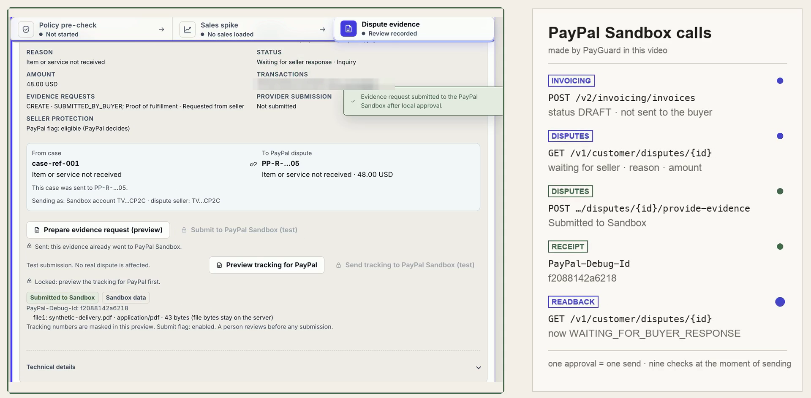
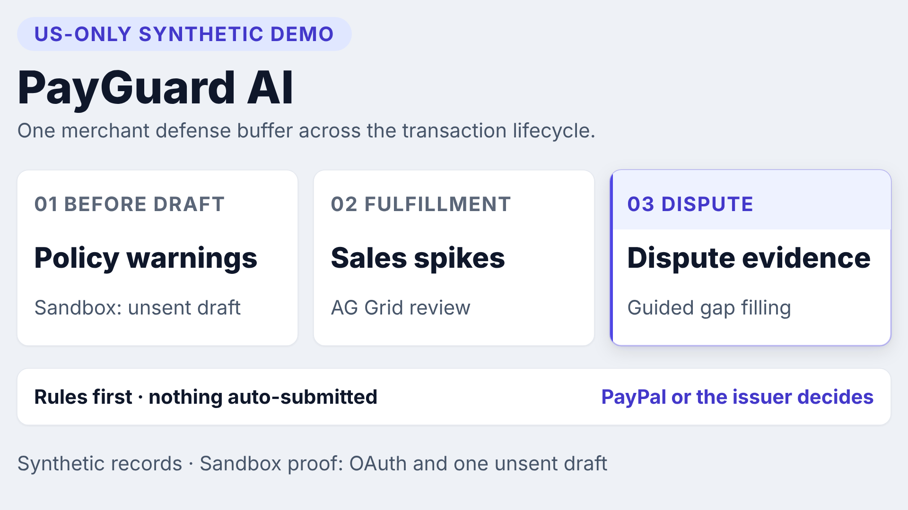
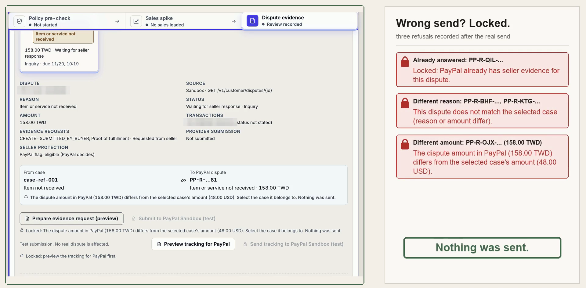
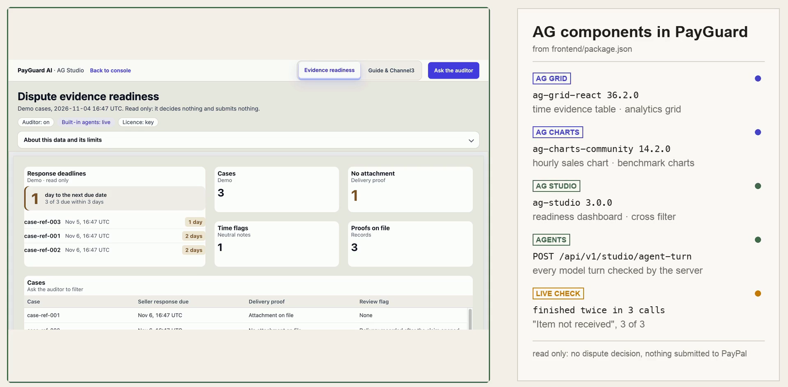
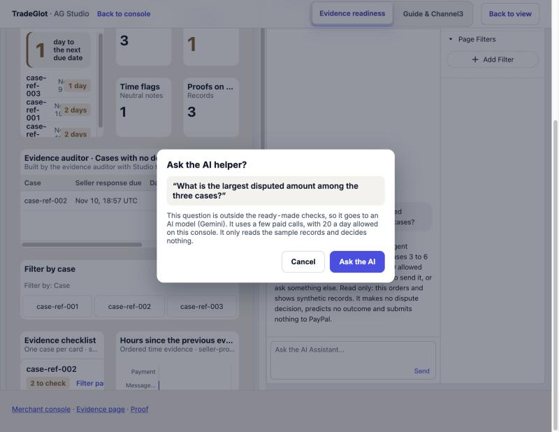
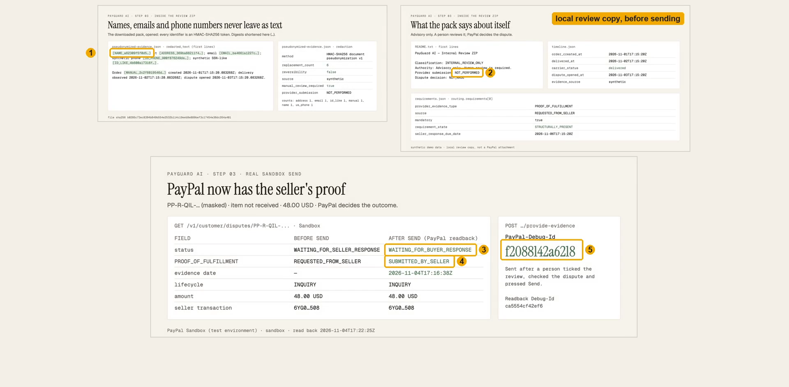
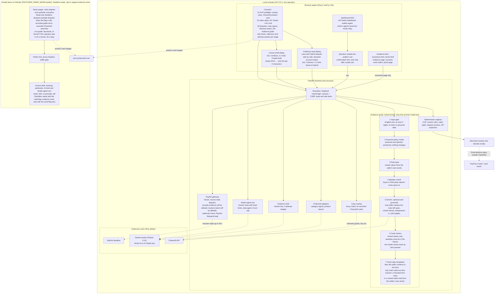
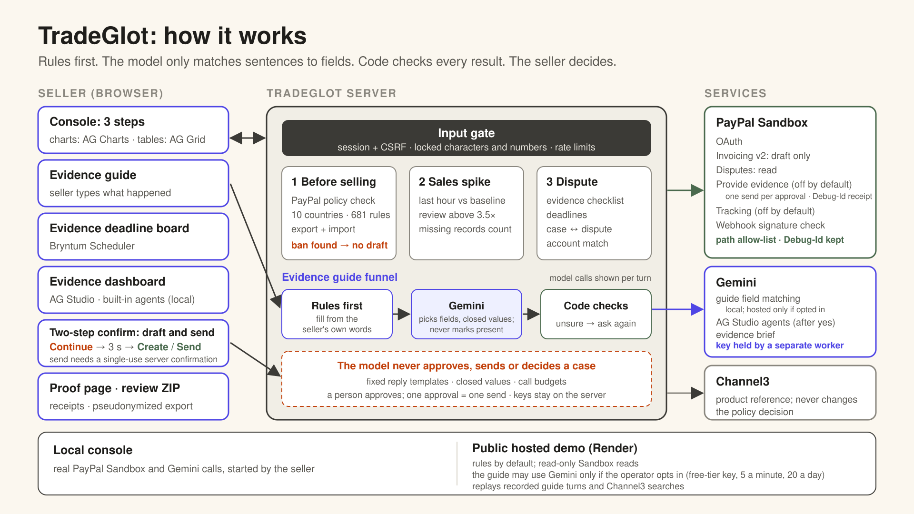
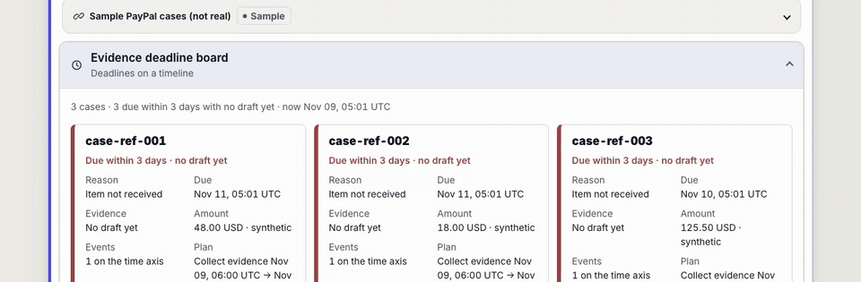

# TradeGlot

Before a small seller ships abroad, TradeGlot checks 681 official rules across ten countries; when a buyer disputes, it turns the seller's records into evidence sent to PayPal Sandbox only after a person approves.

**TL;DR**
- **One seller:** a small online seller who ships across borders.
- **One loss:** a buyer says the parcel never arrived; 48.00 USD is at stake.
- **One PayPal action:** TradeGlot builds the evidence from the seller's records and, after one human approval of the reviewed draft plus a two-step send confirmation, sends it with `provide-evidence`.

**Recorded, with files you can open:** six recorded `provide-evidence` sends to author-created Sandbox test disputes (five from the local console, one from the hosted demo), two of the local ones with a PayPal read-back whose file SHA-256 matches the one recorded at send time ([READBACK_20261109.md](docs/evidence/READBACK_20261109.md)); 681 sourced export and import rules across ten countries and 140 PayPal clauses, each row linked to its source; the last recorded full run (2026-11-09, Run 1 in [TEST_RUN_20261109_SKIPPED.md](docs/evidence/TEST_RUN_20261109_SKIPPED.md)) passed 1,170 tests; the attack request matrix in the suite sends 1,727 hostile requests, with 0 broken in every run recorded in [TEST_RUN_20261108.md](docs/evidence/TEST_RUN_20261108.md).

**The PayPal main line**

List disputes → read one → one human approval of the reviewed draft plus a two-step send confirmation → provide evidence → PayPal-Debug-Id → read-back match.

| Step | Call or action | Evidence |
| --- | --- | --- |
| List disputes | `GET /v1/customer/disputes` | [RECEIPT_20261031_live.md](docs/evidence/RECEIPT_20261031_live.md) |
| Read one | `GET /v1/customer/disputes/{id}`; reason and amount must match the case | [RECEIPT_20261105_live.md](docs/evidence/RECEIPT_20261105_live.md) |
| One approval, two-step confirmation | approve the reviewed draft once; confirm the send in two steps (tick, Continue, 3-second hold, Send) | `tests/frontend_send_confirm_r31.mjs`, `tests/test_send_confirmation.py` |
| Provide evidence | `POST /v1/customer/disputes/{id}/provide-evidence` with a single-use server confirmation | [RECEIPT_20261104_live.md](docs/evidence/RECEIPT_20261104_live.md) |
| PayPal-Debug-Id | e.g. `ca5782cf8df90` (2026-11-09) | [READBACK_20261109.md](docs/evidence/READBACK_20261109.md) |
| Read-back match | `WAITING_FOR_BUYER_RESPONSE`; the 2,015-byte file PayPal serves back has the SHA-256 recorded at send time | [READBACK_20261109.md](docs/evidence/READBACK_20261109.md) |

Six sends were made this way, each to its own author-created Sandbox test dispute: five from the local console (2026-11-04, 2026-11-05 and three on 2026-11-09) and one from the public hosted demo on 2026-11-10 ([RECEIPT_20261110_hosted_live.md](docs/evidence/RECEIPT_20261110_hosted_live.md)). The 2:32 video shows the hosted send of 2026-11-10; an earlier cut, since removed, showed a separate local send that has no receipt and is not counted.

[Start here (judges)](https://payguard-demo-j2b3.onrender.com/start.html) · [Hosted demo](https://payguard-demo-j2b3.onrender.com) · [Proof page](https://payguard-demo-j2b3.onrender.com/proof.html) · [Video (2:32)](https://youtu.be/upx5eZYOmC0) · [Demo package (11 MB zip)](https://github.com/jiarong0423/payguard-ai/releases/download/demo-package-20261109/tradeglot-demo.zip) · [Devpost](https://devpost.com/software/payguard-ai-zbsp9l)

**Hosted demo, in short:** live PayPal Sandbox reads of the author's test disputes (masked ids; shared budget 20 a minute, 500 a day), an evidence guide that can use Gemini when the operator turns it on (at most 5 calls a minute and 20 a day across all visitors; past those caps, or without the opt-in, it answers from keyword rules), and, with the send opt-in, one real capped evidence send per prepared test dispute, with the same gate as the local console: one human approval of the reviewed draft plus a two-step send confirmation. The evidence is built from the demo's synthetic seller records, PayPal is read again before the send, and each visit gets one send (at most 2 sends per address per day); all visitors together get at most 3 sends per 10 minutes and 15 a day, counted per server run. One hosted send was made on 2026-11-10 ([RECEIPT_20261110_hosted_live.md](docs/evidence/RECEIPT_20261110_hosted_live.md)); the hosted test disputes opened that day are listed as due 11/30, so the author plans to open new ones around 11/25 to 11/28. The first visit can take about a minute while the free server wakes.

**Three clicks:** (1) [start page](https://payguard-demo-j2b3.onrender.com/start.html) → **Run the step 1 example**; expect "A listed rule may apply to this sale." (2) **Dispute evidence** (03) in the top stepper → select a case → **Prepare evidence draft** → **Download review ZIP** (7 entries). (3) **Proof** in the top bar.

Also included: a policy and ten-country rules check before shipping (681 rules, 140 PayPal clauses), a sales-spike review (AG Charts, AG Grid) and a Bryntum evidence deadline board.

**Scope:** Sandbox only, synthetic data, author-created test disputes. "Accepted" means PayPal Sandbox recorded the request and the dispute left waiting for the seller (waiting for the buyer after the local sends, under review after the hosted send); it is not a verdict. Byte match covers two of the six sends. The account match uses an operator-set seller id, not verified with PayPal. Country rules: 112 of 681 sampled, 92 compared by an AI reader, no human re-read. No user study. Not legal advice. Formerly named PayGuard AI; the receipts and the Devpost and repository addresses keep that name. Full list: [Real vs simulated](#real-vs-simulated).

**Sponsor tools at a glance** (versions and file names: [docs/SPONSOR_TECH_MAP.md](docs/SPONSOR_TECH_MAP.md)):

| Tool | Depth | What ran | Scope | Evidence |
| --- | --- | --- | --- | --- |
| PayPal Sandbox API | deep | OAuth, unsent invoice drafts, dispute reads, the gated `provide-evidence` send | Six sends to author-created test disputes: five local and one from the hosted demo (capped, with its send opt-in) | [RECEIPT_20261104_live.md](docs/evidence/RECEIPT_20261104_live.md), [RECEIPT_20261110_hosted_live.md](docs/evidence/RECEIPT_20261110_hosted_live.md), [RECEIPT_20261105_live.md](docs/evidence/RECEIPT_20261105_live.md), [READBACK_20261109.md](docs/evidence/READBACK_20261109.md) |
| AG Grid, AG Charts, AG Studio | deep | Order and case grids, charts, an evidence dashboard with a custom auditor | Community Grid and Charts, no Enterprise features; AG Studio's built-in agents ran live on the local console on 2026-11-04 (several runs, none saved), on 2026-11-08 (one run, recorded) and on 2026-11-09 (three runs, 11 tool calls, recorded); the hosted dashboard replays the recording dated 2026-11-09, with its four questions, and calls no model. | [AG_GRID_USAGE.md](docs/evidence/AG_GRID_USAGE.md), [AG_STUDIO_LIVE_RUNS_20261109.md](docs/evidence/AG_STUDIO_LIVE_RUNS_20261109.md), [docs/AG_STUDIO_NOTES.md](docs/AG_STUDIO_NOTES.md) |
| Bryntum Scheduler | deep | Evidence deadline board with a draggable "Collect evidence" bar | Community tier only; hosted | [BRYNTUM_LICENSE_CHECK.md](docs/BRYNTUM_LICENSE_CHECK.md) |
| TradeGlot's own MCP server (not PayPal's) | used | Five read-only tools over stdio | Local only. It is TradeGlot's own server. PayPal's official MCP server was also run once, read-only, against the Sandbox (next row) | [docs/MCP_SERVER.md](docs/MCP_SERVER.md) |
| Render | used | Free Docker web service hosts the demo; a Workflow service with two checks deployed from this repository | Workflow run three times on 2026-11-09, each started on demand from the Render dashboard (4 to 4.2 s each, all succeeded; receipt `ok:true` recorded for the first); not scheduled | [RENDER_WORKFLOW_RUN_20261109.md](docs/evidence/RENDER_WORKFLOW_RUN_20261109.md) |
| Gemini | used | Closed-option evidence guide, evidence brief, Studio agent turns | Brief and Studio agents local only; hosted guide runs on keyword rules and uses Gemini only if the operator opts in (5 calls a minute, 20 a day, then back to keywords); the current brief contract has one live run | [BRIEF_LIVE_RUN_20261109.md](docs/evidence/BRIEF_LIVE_RUN_20261109.md), [GUIDE_BENCHMARK.md](docs/evidence/GUIDE_BENCHMARK.md) |
| Postman | used | Collection of 37 requests, run with Newman | Two Newman runs against the local console: a 10-request read-only subset (19 assertions) and a 25-request run collection covering 21 of the 37 operations (82 assertions, 0 failed, 3 deliberate negative cases); the 16 operations that reach PayPal or a model are not run; not a cloud monitor | [POSTMAN_RUN_20261109.md](docs/evidence/POSTMAN_RUN_20261109.md) |
| APIMatic | used | OpenAPI 3.1 description (37 operations) validated; portal and `llms.txt` [published on GitHub Pages](https://jiarong0423.github.io/payguard-ai/portal/), SDKs generated locally | 0 errors after fixes (first run found 345); the portal is documentation only (the API runs locally; the spec declares the session headers and has examples, 19 media types still without one), SDKs not published, no score claimed | [APIMATIC_RUN_20261109.md](docs/evidence/APIMATIC_RUN_20261109.md) |
| Channel3 | light | Product search for the reference card in the review ZIP; a category signal that never affects a decision | Five real searches replayed on the hosted demo; five more on 2026-11-09 with receipts, not replayed; live search local only | [channel3_receipts_v1.json](docs/evidence/channel3_receipts_v1.json), [channel3_receipts_20261109.json](docs/evidence/channel3_receipts_20261109.json) |
| PayPal's official MCP server (`@paypal/mcp`) | light | `disputes.list` and `disputes.get` only | One read-only run on 2026-11-09: both calls succeeded; not part of the product path | [OFFICIAL_PAYPAL_MCP_RUN_20261109.md](docs/evidence/OFFICIAL_PAYPAL_MCP_RUN_20261109.md) |



*Frame from the 2026-11-10 hosted-site recording (payguard-demo-j2b3.onrender.com), not a mock.*

**Hosted demo (synthetic data plus the owner's PayPal Sandbox test account, never live credentials):** [payguard-demo-j2b3.onrender.com](https://payguard-demo-j2b3.onrender.com) (console) and [/dashboard.html](https://payguard-demo-j2b3.onrender.com/dashboard.html) (AG Studio evidence dashboard). It makes read-only Sandbox reads (connect, list and open the author's own Sandbox test disputes; all visitors share a read budget of 20 a minute and 500 a day); with the owner's send opt-in (`PAYGUARD_HOSTED_SANDBOX_SEND=enabled`, 2026-11-10) it can also send evidence to the owner's own Sandbox test disputes after one human approval of the reviewed draft plus a two-step send confirmation: once per dispute, once per visit, at most 2 sends per address per day, at most 3 sends per 10 minutes and 15 a day for all visitors (counted per server run; a restart resets the counts). Every other write route answers 503. Its evidence guide can use Gemini when the operator opts in (free-tier key held as a Render secret, at most 5 calls a minute and 20 a day, guide only); the AI brief and the AG Studio agents stay disabled there. It runs on Render's free plan, so the first request after an idle period may take about a minute while the service wakes. The invoice draft, tracking, the AI brief and the Studio agents need a local run (the evidence send too, unless the send opt-in is on) (see [Run locally](#run-locally)).

**How to judge in 5 minutes** (hosted demo, synthetic data and the owner's Sandbox test account, no keys needed from you):
1. Open the hosted demo, **Step 01**: select **Run the step 1 example**. It fills ship from **United States** to **Singapore**, ticks **E-cigarettes** and runs **Check country rules** (the same local rules check; no PayPal call, no model call), then scrolls to the result. Expect "A rule may stop this sale", each row linked to its source.
2. Pick **Needs-review sample** and run the policy check. Expect a **REVIEW SIGNAL**: a reminder, not a verdict.
3. Select **Next: sales burst** (under step 01) to open **Step 02**, then **Load sales burst**. Expect a synthetic spike against a declared baseline, with the records that back it and the ones still missing.
4. Select **Dispute evidence** (03) in the top stepper to open **Step 03** (the **Next: dispute evidence** button under step 02 does the same once you scroll to it). The demo cases load by themselves (the **Load dispute case** button shows only when the list is empty). Select a case, then **Prepare evidence draft**. Expect "Ready for human review" and an Internal Review ZIP with seven entries (six listed files and the manifest); download it and open it, or read [what each entry holds](docs/evidence/REVIEW_ZIP_CONTENTS.md). Below the case, **Try the send: a recorded replay** lets you click through the two-step send (tick, Continue, a three-second wait, Send) and then shows what the real Sandbox send of 2026-11-05 recorded. It is labelled "Recorded, nothing is sent". The **PayPal Sandbox disputes** block lists the owner's Sandbox test disputes; on the hosted site it is usually already connected, and its **Connect US Sandbox** button shows only when it is not. When the send opt-in is on, with case-ref-001 drafted and its local review confirmed, open a dispute that waits for the seller (item not received, 48.00 USD), prepare the preview and send it through the dialog; the page then shows SUBMITTED, the PayPal-Debug-Id and a fresh read of the dispute. When no test dispute is left waiting for the seller, or the shared cap is used up, the page says so and opens the recorded replay.
5. Open **Proof** in the top bar (on a phone, use the **Proof and receipts** link under the page title): each claim, how it was shown, the date and the source file. The real Sandbox runs are in `docs/evidence/RECEIPT_*.md` (2026-10-31, 11-04, 11-05 and the hosted send of 11-10, masked, with PayPal-Debug-Ids) and in `docs/evidence/READBACK_20261109.md` (the three sends of 2026-11-09).
6. Check the numbers yourself: `.venv/bin/python3 -B tools/verify_public_numbers.py` (after the Run locally setup; no network) prints each count in this README next to what it measures, and marks the Python test lines MANUAL instead of guessing when it runs without the project packages; `./tools/run.sh test` runs the suite. The answer-key evaluation is `docs/evidence/CHECKLIST_ANSWER_KEY_EVAL.md`; the rules source spot-checks are `docs/evidence/RULES_SPOTCHECK_20261108.md` (48 rules) and `docs/evidence/RULES_SPOTCHECK_20261110.md` (second draw, random seed 20261110, run on 2026-11-09) (64 more rules and 24 more clauses).

Times on screen: a time marked UTC is UTC (as on the AG Studio dashboard, the Evidence deadline board, the Time evidence block and Technical details); every other time in the console, including the PayPal Sandbox dispute list, is shown in your own time zone with its name (for example GMT+8).

**Limits:**

- Real PayPal calls are Sandbox only. Six evidence sends were made to author-created test disputes and are kept as receipts ([details](#real-vs-simulated)): five from the local console and one from the hosted demo on 2026-11-10 with its send opt-in, under the caps above.
- On 2026-11-09, for two of three sends, the file PayPal stores had the same SHA-256 as the file recorded at send time; the third was not compared. A match does not mean PayPal accepted the evidence.
- There was no user study.
- Country rules: 112 of 681 were sampled and 92 compared with their official pages by an AI reader, with no human re-read: 62 consistent, 30 worded differently, 0 contradicted, 20 could not be opened. The rest are unchecked.

<details>
<summary>How the country rules work (140 clauses, 681 rules, sources)</summary>

**Country rules (step 01, Policy pre-check, optional):** before an invoice draft, the seller can pick the country the parcel ships from and the country it ships to, and tick the goods. The check is optional on the server: a draft can be created without one. Two layers answer, each row linked to its own source. PayPal's own published rules: ten country profiles and 140 clauses paraphrased from PayPal's legal hub pages (all linked to paypal.com; snapshot dates shown per row; two recorded spot-checks sampled 48 of them and compared 45 with PayPal's pages: 3 with a minor inconsistency (all from the first draw), 9 incomplete, 8 wording differs, the rest consistent, and 3 not located; see docs/evidence/PAYPAL_CLAUSES_SPOTCHECK_20261108.md and docs/evidence/RULES_SPOTCHECK_20261110.md (second draw, random seed 20261110, run on 2026-11-09); the other 92 are unchecked; an AI reader's verdicts, no human re-read). Official export and import rules: 681 rules (313 export, 368 import) from government pages and postal operators, with the statute and article where one exists. Once a check has been run in the session, a PayPal or government ban in that check stops the Sandbox invoice draft on the server, not only by a greyed-out button; a ban that binds the post only shows as "The post will not carry this item" and the seller can continue with another carrier. It is not legal advice, and PayPal's Acceptable Use Policy still applies.

</details>

<details>
<summary>How this relates to PayPal's own tools</summary>

**How it relates to PayPal's own tools:** TradeGlot does not replace PayPal's Resolution Center or seller protection and decides no case. It works on the seller side before and around them: it flags policy wording before an invoice draft, checks where a parcel ships from and to, shows whether a sales spike has the order records to back it, and prepares an evidence draft that a person reviews against PayPal's official sources. No merchant interviews or pain-point statistics are claimed; the problem statement is a design premise, not a measured finding.

</details>

<details>
<summary>Why these three situations (UK ombudsman decisions)</summary>

**Why these three situations:** the stages follow published decisions of the UK Financial Ombudsman Service about PayPal accounts, checked against the published PDFs on 2026-10-31. [DRN-3621543](https://www.financial-ombudsman.org.uk/decision/DRN-3621543.pdf): an e-liquid seller could no longer receive payments because the goods needed PayPal's pre-approval under its Acceptable Use Policy (complaint not upheld). [DRN-5706769](https://www.financial-ombudsman.org.uk/decision/DRN-5706769.pdf): a new business account with a sharp rise in sales had part of its funds held and a 15% rolling reserve applied (the reserve was found reasonable; GBP 150 was awarded for an unexplained delay in releasing funds). [DRN-3526295](https://www.financial-ombudsman.org.uk/decision/DRN-3526295.pdf): a buyer's Buyer Protection claim over a watch that did not match its description (upheld; this is the buyer's side, which TradeGlot does not act for). These are UK decisions about PayPal's UK and European entities, not US cases, and three cases show a pattern, not an incidence rate. The author collected further public sources for the project; they are not included in this repository.

</details>

<details>
<summary>Time evidence: the late-delivery case</summary>

**Time evidence (synthetic case 2):** a buyer pays for a digital item, no order record exists yet, the seller delivers later, and a refund claim lands inside that gap. TradeGlot keeps the payment time, the order-record time, message records (a channel, a direction, a time, a closed topic and a keyed digest, never text), the delivery time and the claim time in one ordered record inside the Internal Review ZIP (`timeline.json`, schema v2), computes the gaps between them, and lists neutral timestamp flags. Every event except the claim time is marked seller-provided and not verified. It states no intent, predicts no outcome and gives no legal advice; PayPal and the card issuer decide. A digital delivery (channel and time) can stand in for a tracking number as fulfilment proof; mapping it to PayPal's `PROOF_FOR_SOFTWARE_OR_SERVICE_DELIVERED` request type is not implemented, and nothing is submitted.

</details>

<details>
<summary>Technology list and dated Sandbox runs (open only to verify)</summary>

**Working stack:** PayPal Sandbox OAuth, an unsent invoice draft, Disputes list and detail reads and a gated `provide-evidence` request (previewed; sent only behind local approval and an opt-in flag; sent to six Sandbox test disputes: five from the local console (2026-11-04, 2026-11-05, three on 2026-11-09) and one from the hosted demo (2026-11-10)) · FastAPI and deterministic rules · React and Tailwind · AG Grid, AG Charts and AG Studio · Bryntum Scheduler Community (evidence deadline board: case data read only, plus a local-only "Collect evidence" plan bar you can drag or resize) · Gemini (Vertex AI for the evidence brief; Vertex AI or an AI Studio API key for the evidence guide and for AG Studio's built-in agents).

**Run against the real Sandbox** (author-created test cases between two Sandbox test accounts, not real merchant cases; dates are UTC+8 unless marked UTC; receipts also give UTC):
- **2026-10-06 (17:44 UTC) and 2026-10-31:** OAuth client-credentials and one unsent invoice draft each (2026-10-06: USD 10.00, `INV2-...-W5UW`, status `DRAFT`). On 2026-10-31 the author filed one test dispute (item not received, TWD 158.00; the test payment was in TWD) from a Sandbox buyer test account; a list read 2.4 minutes after filing was empty, a read at 12.7 minutes returned it (waiting for the seller's response, inquiry stage), shown in step 03 under **PayPal Sandbox disputes** with the badge **Sandbox**, and its detail was read. No `provide-evidence` call that day. [Receipt](docs/evidence/RECEIPT_20261031_live.md).
- **2026-11-04:** after the local review and the two-step send dialog, TradeGlot sent evidence to an author-created test dispute (item not received, USD 48.00); PayPal Sandbox accepted the request (PayPal-Debug-Id `f908765a01293`) and the dispute moved to waiting for the buyer, which is not a decision on the evidence. The evidence file was a 43-byte synthetic placeholder PDF. Two test disputes whose reason did not match the case were refused before any send. [Receipt](docs/evidence/RECEIPT_20261104_live.md).
- **2026-11-05 (2026-11-04 17:16 UTC), during the video recording:** a second send to a newly filed test dispute of the same kind (PayPal-Debug-Id `f2088142a6218`); the fresh read after it (PayPal-Debug-Id `ca5554cf42ef6`) showed waiting for the buyer. A first attempt after the local session had expired was refused and nothing went out; afterwards a re-send to that dispute and a dispute with a different amount were refused. A third unsent invoice draft (`INV2-...RG5U`, `DRAFT`, not sent) was created in the same recording. [Receipt](docs/evidence/RECEIPT_20261105_live.md).
- **2026-11-09:** three more sends, each to its own author-created test dispute (item not received), with a generated 2,015-byte delivery PDF; PayPal accepted each request and each dispute showed waiting for the buyer. For two of them the file PayPal serves back has the same SHA-256 as the file recorded at send time ([read-back note](docs/evidence/READBACK_20261109.md)); the first of the three was sent before fingerprints were recorded and was not compared. The same day the hosted demo was checked live with read-only Sandbox reads ([note](docs/evidence/HOSTED_READONLY_LIVE_20261109.md)).
- **2026-11-10:** one send from the public hosted demo (Render, commit `b50aa6d`, send switch on) to an author-created item-not-received test dispute of 48.00 USD: SUBMITTED with PayPal-Debug-Id `f869050ae2a63`; the read-back right after showed "Under review" (PayPal-Debug-Id `f2530346edb95`). The stored file was not compared byte for byte ([RECEIPT_20261110_hosted_live.md](docs/evidence/RECEIPT_20261110_hosted_live.md)).
- `./tools/run.sh test` runs the full suite and prints the count to quote. The first commit of this repository is dated 2026-10-08, inside the submission period.

</details>

### Try it in 60 seconds

On the [hosted demo](https://payguard-demo-j2b3.onrender.com) (synthetic data, Sandbox reads and, with the send opt-in, a capped evidence send; the guide may use Gemini when the operator opts in, at most 5 calls a minute and 20 a day), use **Start here** at the top:

1. **Policy pre-check:** in the country rules card, ship from **United States** to **Singapore**, tick **E-cigarettes** and select **Check country rules**. The result reads "A listed rule may apply to this sale." (a cited PayPal, government or post rule matches; PayPal's own decision may differ), each rule row marked **Stopped** or **Check first** and linked to its source; once a ban is found, the server refuses the Sandbox invoice draft (HTTP 409).
2. Select **Change** next to the goods, untick **E-cigarettes** and check again: the result reads "No cited rule stops this sale." followed by "This is not clearance. Only the listed country and PayPal rules were checked; payment type, address match and carrier limits are not covered.", and the before/after card shows "Stopped at <time> → Clear at <time>" with what changed ("Clear" only means no listed rule matched). This shows the check reacts to the declared goods; declare what you actually sell, because re-checking with different goods does not change what you actually sell.
3. **Sales spike:** the AG Charts chart shows the last hour at 5× the usual rate against the review line; the card under it lists the order records that back the signal, the records that are missing (tracking, delivery, messages) and the published reserve case it relates to. It predicts no PayPal action.
4. **Dispute evidence:** below the case queue, open **Evidence deadline board**. It shows each case's response window up to its due date; the board's label reads "case data read only", and only the "Collect evidence" bar can be dragged or resized. The plan stays in your browser.
5. Select **Download review ZIP** for the case's internal evidence package, which includes the ordered time record.
6. **Proof** in the top bar (`/proof.html`) lists what has been shown so far, how, on what date and from which file, each row marked as a real Sandbox call, a recorded real run, an automated test or synthetic data.

### Why the AI part drifts so little

Rules and code run first. The model only maps a seller's sentence to closed form items and a closed tag, and code, not the model, decides what is complete. Of the 601 scored replies, 328 were pasted by hand from a desktop session, the record does not show whether any reply was set aside before scoring, and this is a fixed corpus, not a measure of decision accuracy. Within those limits, 0 of 601 were outside the closed JSON format. There were 0 confident-wrong fills in all v4 runs (limit: 268 form-guidance cases, not verdict correctness). A change only counts as an improvement if wrong values stay at 0. Evidence: [GUIDE_STRESS_TEST.md](docs/evidence/GUIDE_STRESS_TEST.md), [GUIDE_BENCHMARK.md](docs/evidence/GUIDE_BENCHMARK.md).

### Foolproofing you can see

Every action that writes to PayPal Sandbox, spends the Studio allowance or wipes the session asks first (`tests/frontend_foolproof_20261104.mjs`). A send needs a local review, a two-step dialog, a 3-second hold and a single-use server confirmation (`tests/frontend_send_confirm_r31.mjs`, `tests/frontend_send_guard_r25.mjs`, `tests/test_send_confirmation.py`). Locked buttons say why (`tests/frontend_lock_reasons_r31.mjs`). A send to a dispute whose reason or amount differs, or that already has seller evidence, is refused and nothing is sent ([RECEIPT_20261104_live.md](docs/evidence/RECEIPT_20261104_live.md), [RECEIPT_20261105_live.md](docs/evidence/RECEIPT_20261105_live.md)); the 15-minute demo session expiry refused a send in the recorded run (RECEIPT_20261105_live.md). These are guards that stop mistakes, not proof that PayPal accepts the evidence.

### Safety checks you can see

Review and attack rounds were run against the build with independent reviewer agents (judge, PayPal developer relations, sponsor panel, security engineer, UI/UX) and attack agents (a backend request matrix, a desktop browser and a real Android phone); each finding was re-checked by the author, and each fix was followed by the full test suite. Nothing in them called PayPal Live or a real payment. Three of these rounds, for example, found and fixed policy pre-screen evasions (combining marks, lookalike letters, glued, split and leet spellings), a traffic-layer stall by one address, and a stale country result after Reset. The round-by-round table, with what was found and what happened to it, is in [RED_TEAM_ROUNDS_20261104.md](docs/evidence/RED_TEAM_ROUNDS_20261104.md) and [RED_TEAM_ROUNDS_ADDENDUM_20261108.md](docs/evidence/RED_TEAM_ROUNDS_ADDENDUM_20261108.md); its limits (the pre-screen is a keyword screen that asks a person to review, the country check is advisory) are listed there too.

To re-run them: `./tools/run.sh test` runs the request matrix (`tests/test_redteam_input_matrix.py`), the evasion tests (`tests/test_attack_r22.py`, `tests/test_attack_r23_aup.py`), the traffic tests (`tests/test_traffic.py`) and the console attack scripts (`tests/frontend_attack_r21_console.mjs` to `frontend_attack_r23_secondary.mjs`). The matrix prints a `round regression` line; the last recorded run printed 1727 requests, BROKEN 0, GAP 0 ([TEST_RUN_20261108.md](docs/evidence/TEST_RUN_20261108.md)). How that number is counted: [HOW_NUMBERS_WERE_COUNTED.md](docs/evidence/HOW_NUMBERS_WERE_COUNTED.md). These are tests of the author's own build, not an outside security audit.

### Real vs simulated

**Real** means a live call against the provider was made and a receipt or record exists. **Built, not yet run live** means the code path exists and is covered by tests with mocked transports or fake models only. **Simulated** means sample data or a replay of recorded calls.

| Capability | Status | Evidence |
| --- | --- | --- |
| PayPal OAuth (`POST /v1/oauth2/token`) | Real, 2026-10-06 and 2026-10-31, and on 2026-11-04, 2026-11-05 and 2026-11-09 for the reads, sends and the third draft, and on the hosted demo on 2026-11-09 (read-only check) and 2026-11-10 (around the hosted send); every call needs the token and is not logged separately | [masked receipt 2026-10-31](docs/evidence/RECEIPT_20261031_live.md); the 2026-10-06 facts are in "Provider and model evidence" (raw responses not stored) |
| PayPal Invoicing v2 draft (`POST /v2/invoicing/invoices`) | Real, 2026-10-06 (`INV2-...-W5UW`), 2026-10-31 and one during the video recording on 2026-11-05 (UTC+8, `INV2-...RG5U`); never sent | same receipts; [masked receipt 2026-11-05](docs/evidence/RECEIPT_20261105_live.md) |
| PayPal Disputes list (`GET /v1/customer/disputes`) | Real, 2026-10-31 (one author-created Sandbox test case), and again around the sends on 2026-11-04, 2026-11-05 and 2026-11-09, and on the hosted demo on 2026-11-09 (read-only check) and 2026-11-10 (around the hosted send); sample data without a connection | [masked receipt 2026-10-31](docs/evidence/RECEIPT_20261031_live.md) |
| PayPal Disputes detail (`GET /v1/customer/disputes/{id}`) | Real, 2026-10-31 (HTTP 200, same test case), and fresh reads after each send on 2026-11-04, 2026-11-05 and 2026-11-09 (readback PayPal-Debug-Id `ca5554cf42ef6` on 2026-11-05), on the hosted demo on 2026-11-09 (read-only check) and after the hosted send on 2026-11-10 (read-back PayPal-Debug-Id `f2530346edb95`) | same receipts; [hosted check 2026-11-09](docs/evidence/HOSTED_READONLY_LIVE_20261109.md), [hosted receipt 2026-11-10](docs/evidence/RECEIPT_20261110_hosted_live.md) |
| PayPal `provide-evidence` | Real (Sandbox), six sends, each to its own author-created test dispute: 2026-11-04 (PayPal-Debug-Id `f908765a01293`; the evidence file was a 43-byte synthetic placeholder PDF), 2026-11-05 (`f2088142a6218`, read-back `ca5554cf42ef6`), three on 2026-11-09 (read-back note, see the known limits) and one from the hosted demo on 2026-11-10 (`f869050ae2a63`). Mismatched, unauthorized, already-answered and different-amount test disputes were refused. Sent only behind local approval, `PAYGUARD_PAYPAL_DISPUTE_SUBMIT=enabled`, `submit: true` and the server's single-use send confirmation | [masked receipt 2026-11-04](docs/evidence/RECEIPT_20261104_live.md), [masked receipt 2026-11-05](docs/evidence/RECEIPT_20261105_live.md), [read-back note 2026-11-09](docs/evidence/READBACK_20261109.md), [masked receipt 2026-11-10, hosted](docs/evidence/RECEIPT_20261110_hosted_live.md); no call was made on 2026-10-31; mocked-transport tests |
| PayPal webhook signature check | Built, not yet run live (no UI path): the raw event is posted back verbatim, as PayPal requires; afterwards only a projection is returned (event id, event type, resource type, resource id and resource status) and nothing is stored | mocked-transport tests |
| PayPal shipment tracking (`POST /v1/shipping/trackers-batch`; PayPal marks this endpoint deprecated (legacy), and Orders v2 tracking, `POST /v2/checkout/orders/{id}/track`, is the current path, which TradeGlot does not call yet) | Built, not yet run live: previewed in step 03, sent only behind the local review approval, `PAYGUARD_PAYPAL_TRACKING_SUBMIT=enabled` and `submit: true`; carrier from PayPal's list, empty tracking numbers refused | mocked-transport tests (`tests/test_paypal_r24.py`) |
| Gemini evidence guide | Real: 2026-11-02 (116 calls, 0 errors, an earlier prompt contract, [GUIDE_STEPS12_LIVE.md](docs/evidence/GUIDE_STEPS12_LIVE.md)), 2026-11-03 (`gemini-3.8-flash`, 36 API calls) and 2026-11-04 on the owner's local console (five scenario sentences, 12 rounds each; four used the model, one was settled by the rule layer); the hosted demo also replays recorded turns, and its live guide can use Gemini when the operator opts in (free-tier key, at most 5 calls a minute and 20 a day) | [GEMINI_GUIDE_RUNS_20261103.md](docs/evidence/GEMINI_GUIDE_RUNS_20261103.md); stress test in "How the guide was stress-tested" |
| Gemini evidence brief (Vertex AI) | Real once, 2026-10-06, under an earlier prompt contract; the current `v3` contract ran live once on 2026-11-09 on the local console ([record](docs/evidence/BRIEF_LIVE_RUN_20261109.md)) | "Provider and model evidence" (receipt kept by the author, not in this repository) |
| Channel3 product search (`POST /v1/search`) | Real, 2026-11-01 (5 calls) and 2026-11-09 (5 more), all HTTP 200; the hosted demo replays only the first five | [channel3_receipts_v1.json](docs/evidence/channel3_receipts_v1.json), [channel3_receipts_20261109.json](docs/evidence/channel3_receipts_20261109.json) |
| Channel3 category search (`GET /v1/categories/search`) | Built, not yet run live (fake transport only) | `tests/test_channel3.py` |
| AG Studio built-in agents | Real, 2026-11-04 (local console, `gemini-3.8-flash`): the first attempts failed (a 422 on an over-long tool description, then a 502; both fixed), one question ran six agent turns all HTTP 200, the reason-code question twice used all 20 calls before the data-agent change and finished twice in 3 calls after it; on 2026-11-08 one question was recorded to `frontend/src/data/studio_agent_run_v1.json`; on 2026-11-09 three more questions ran live on the local console (11 Studio tool calls, all finished) and were added to the same file. The hosted dashboard replays the recording dated 2026-11-09, with its four questions, and calls no model. The custom auditor agent runs locally on the synthetic case data | [AG_STUDIO_NOTES.md](docs/AG_STUDIO_NOTES.md), [AG_STUDIO_LIVE_RUNS_20261109.md](docs/evidence/AG_STUDIO_LIVE_RUNS_20261109.md) |
| Render hosting | Real: one free Docker web service (Blueprint, manual deploy) runs the hosted demo at [payguard-demo-j2b3.onrender.com](https://payguard-demo-j2b3.onrender.com) with PayPal Sandbox reads and an opt-in, capped evidence send (Sandbox test account only); only its guide can call Gemini, when the operator opts in | `render.yaml`, `Dockerfile`, "Hosted demo" below |
| Render Workflows | Two-check variant deployed from this repository and run three times on 2026-11-09, each started on demand from the Render dashboard (each succeeded in about 4 s; the first run's receipt `ok:true` is recorded); not scheduled | [RENDER_WORKFLOW_RUN_20261109.md](docs/evidence/RENDER_WORKFLOW_RUN_20261109.md), [notes](docs/RENDER_WORKFLOWS_NOTES.md), `workflows/evidence_integrity/` |
| Sales spike orders, sample disputes, evidence ZIP | Simulated by design (synthetic data) | "Three-stage contract" below |

**Known limits, in one place:**
- Six `provide-evidence` requests were sent, each to its own author-created Sandbox test dispute: five from the local console, on 2026-11-04 and 2026-11-05 ([masked receipt](docs/evidence/RECEIPT_20261104_live.md), [masked receipt](docs/evidence/RECEIPT_20261105_live.md)) and three times on 2026-11-09 ([read-back note](docs/evidence/READBACK_20261109.md)), and one from the hosted demo on 2026-11-10 ([masked receipt](docs/evidence/RECEIPT_20261110_hosted_live.md)); no shipment-tracking request has been sent live yet. Each was previewed and gated.
- Byte comparison covers two of the six sends. On 2026-11-09 three `provide-evidence` requests carried a generated 2,015-byte delivery PDF instead of the 43-byte placeholder. The first was sent before the console recorded file fingerprints, so its bytes were not compared. For the other two the console recorded the SHA-256 of the exact bytes at send time, and each read-back showed the status WAITING_FOR_BUYER_RESPONSE, one seller document named `synthetic-delivery.pdf`, and a download from PayPal whose SHA-256 equals the recorded one, twice ([read-back note](docs/evidence/READBACK_20261109.md)). Our first read-back attempts answered HTTP 404 because they asked PayPal's content service for JSON; asking for a PDF works. The PDF renderer is deterministic, but the draft's input dates are counted from the moment the draft is prepared, so a send cannot be rebuilt byte for byte later; that is why the fingerprint is recorded at send time.
- The webhook signature check has no UI path and has not verified a live event.
- Country rules: two recorded spot-checks sampled 112 of the 681 rules and compared 92 with their official pages (62 consistent, 30 wording differs but meaning consistent, 0 inconsistent; 20 could not be opened): 48 on 2026-11-08 ([RULES_SPOTCHECK_20261108.md](docs/evidence/RULES_SPOTCHECK_20261108.md)) and 64 more ([RULES_SPOTCHECK_20261110.md](docs/evidence/RULES_SPOTCHECK_20261110.md), second draw, random seed 20261110, run on 2026-11-09); every verdict was made by an AI reader (Claude, working for the author) and no human has re-read them; the other rules are not checked line by line. The check is advisory and is not legal advice.
- All orders, cases and evidence files are synthetic; the live disputes are test cases between Sandbox test accounts.
- AG Studio's built-in agents ran live on the local console on 2026-11-04 (several runs, none saved), on 2026-11-08 (one run, recorded) and on 2026-11-09 (three runs, 11 tool calls, recorded); the hosted dashboard replays the recording dated 2026-11-09, with its four questions, and calls no model ([record](docs/evidence/AG_STUDIO_LIVE_RUNS_20261109.md)). The current Gemini evidence-brief contract was tested against fake models and has run live once, on 2026-11-09 on the local console ([record](docs/evidence/BRIEF_LIVE_RUN_20261109.md)); one run is not a benchmark.
- The hosted demo's PayPal calls are Sandbox reads and, with the send opt-in, at most one evidence send per dispute and per visit, at most 2 sends per address per day (3 per 10 minutes, 15 a day, counted per server run); no invoice or tracking writes; its guide can call Gemini only when the operator opts in (at most 5 calls a minute and 20 a day), and it sleeps when idle on Render's free plan.
- No user study: the guide's numbers are measured proxies on a fixed corpus ("How the guide was stress-tested").
- Pinned references are older than PayPal's pages: PayPal's US Acceptable Use Policy and User Agreement pages both show "Last updated on November 4, 2026" (read 2026-11-08); TradeGlot's pinned references are dated 2022-10-29 and 2026-09-14 and were not refreshed. The 18 pre-approval categories still match; the prohibited-list paraphrase is incomplete. A recorded spot-check of the PayPal clauses is in docs/evidence/PAYPAL_CLAUSES_SPOTCHECK_20261108.md.
- Seller Protection has conditions and exclusions and PayPal decides eligibility per transaction; TradeGlot shows no eligibility and predicts none.

### Judging criteria map

| Criterion | Where to see it |
| --- | --- |
| Technological implementation | The Sandbox gateway with Disputes reads and the gated `provide-evidence` request (table below, "Turning on PayPal"); the server-side stop of a Sandbox invoice draft after a country-rules ban (HTTP 409, `tests/test_country_rules.py`); the test suite and the review and attack-test rounds ([RED_TEAM_ROUNDS_20261104.md](docs/evidence/RED_TEAM_ROUNDS_20261104.md)); how AI drift is controlled, path by path, with the tests and live records ([AI_DRIFT_CONTROL.md](docs/evidence/AI_DRIFT_CONTROL.md)) |
| Design | The three-step console (step 01 Policy pre-check, step 02 Sales spike, step 03 Dispute evidence; [judge quickstart](docs/submission/quickstart.md)); the AG Studio evidence dashboard ([/dashboard.html](https://payguard-demo-j2b3.onrender.com/dashboard.html)); the Bryntum evidence deadline board in step 03 |
| Potential impact | [Sourced size of the setting](docs/evidence/IMPACT_SOURCES_20261109.md) (PayPal's 10-K: 439 million active accounts, buyers included; no loss-reduction claim, no user study); the ten-country rules check (681 official export and import rules plus 140 PayPal clauses, `data/country_rules/`; 112 of the rules were sampled and 92 compared with their pages, by an AI reader with no human re-read); the published UK ombudsman decisions the stages follow ("Why these three situations"); the ordered time evidence in the Internal Review ZIP |
| Quality of the idea | A merchant-side layer before and around PayPal's own tools that decides nothing ("How it relates to PayPal's own tools"); Gemini picks only from closed options that code validates ("AI boundary") |
| Presentation | The [2:32 video](https://youtu.be/upx5eZYOmC0) (2026-11-11; it replaces the earlier 2:59 cut (since removed from YouTube) of 2026-11-10 and the [2:50 cut](https://youtu.be/_GORnHWShU4)); the [hosted demo](https://payguard-demo-j2b3.onrender.com); this README, the [judge quickstart](docs/submission/quickstart.md) and the console's `/proof.html` page (what was shown, how, when, and from which file) |

| What the console does | PayPal call | Real or sample data |
| --- | --- | --- |
| Connect the merchant | `POST /v1/oauth2/token` (client-credentials) | Real Sandbox call with `PAYGUARD_PAYPAL_OUTBOUND=enabled` and your Sandbox app credentials; without them the call answers 503 `provider_disabled` and nothing is simulated |
| Unsent invoice draft after the AUP preflight | `POST /v2/invoicing/invoices` | Real Sandbox call once connected, status `DRAFT`, never sent; without a connection the console shows the AUP warning and stops before the draft. **Create Sandbox draft** first opens a dialog with the item, amount and route ("A draft is created in PayPal Sandbox. It is not sent to the buyer."); the seller ticks "I checked the item and the amount", selects the orange **Continue**, waits 3 seconds and selects the green **Create draft**. The draft line then shows a masked id, `INV2-…` and its last 4 characters |
| Webhook signature check | `POST /v1/notifications/verify-webhook-signature` | Allow-listed Sandbox endpoint; exercised in tests with hand-written mock responses; needs `PAYPAL_WEBHOOK_ID`; no UI path. The event is forwarded as its original raw JSON text (PayPal verifies the exact bytes it sent); nothing from it is stored or logged, and after `SUCCESS` the response carries `verification_status`, `imported_into_demo: false`, the PayPal debug id and an `event` projection of `id`, `event_type`, `resource_type`, `resource_id` and `resource_status` (each kept only if it is a short safe token) |
| Read the seller's dispute list (step 03) | `GET /v1/customer/disputes` | Read live on 2026-10-31: one author-created Sandbox test case was listed (badge **Sandbox**); read again around each send on 2026-11-04, 2026-11-05 and 2026-11-09, and on the hosted demo on 2026-11-09 (read-only check) and 2026-11-10 (around the hosted send); other reasons and more rows are covered by mocked-transport tests. Connect your own Sandbox app to run it live. Without a connection synthetic sample data in the same JSON shape is used, shown as **Sample PayPal cases (not real)** with the badge **Sample** |
| Read one dispute | `GET /v1/customer/disputes/{id}` | Read live on 2026-10-31 for the same test case (HTTP 200), and again after each send on 2026-11-04, 2026-11-05 and 2026-11-09 (receipts and read-back note), and on the hosted demo on 2026-11-09 (read-only check) and 2026-11-10 (around the hosted send); other cases use mocked-transport tests or the sample data |
| Assemble the evidence response | `POST /v1/customer/disputes/{id}/provide-evidence` | Multipart request is built and previewed from the local draft for a dispute id the console itself returned; it is sent only after the local review approval, with `PAYGUARD_PAYPAL_DISPUTE_SUBMIT=enabled`, a Sandbox connection and an explicit `submit: true`. In the console the send opens a dialog that shows the case and the PayPal dispute side by side with the dispute amount, opening date and declared account match (the merchant id is set by the operator, not verified with PayPal); the operator ticks, selects the orange **Continue**, waits 3 seconds and selects the green **Send to PayPal**. After a send the result shows the PayPal-Debug-Id |
| Sales spike stream, dispute checklist, evidence ZIP | none | Local synthetic data by design |



*Workflow map for the synthetic demo: the policy and ten-country rules check, the sales spike review, dispute evidence and the Sandbox send after one human approval; PayPal and issuers retain final authority.*

Screens from an earlier cut (2:50), taken before the rename (the header reads PayGuard AI):

- 
- 
- 
- 

More diagrams: [architecture](docs/submission/diagrams/architecture_overview.png) ([simplified](docs/submission/diagrams/architecture_simple.png)), [where each sponsor tool sits, with its controls](docs/submission/diagrams/sponsor_placement_map.png), [evidence guide funnel](docs/submission/diagrams/evidence_guide_funnel.png), [the nine checks before evidence is sent to PayPal](docs/submission/diagrams/paypal_write_guards.png) and [a downloaded review ZIP, re-hashed and verified](docs/submission/diagrams/review_zip_verified.png).

## Architecture and tools at a glance

For each sponsor technology, what is used, in which file, and whether it is hosted, recorded or local only: [docs/SPONSOR_TECH_MAP.md](docs/SPONSOR_TECH_MAP.md).

**What TradeGlot covers:** one seller-side path covers a policy and country-rules pre-check, sales spike review, dispute preparation and a gated Sandbox send. Deterministic checks make each signal inspectable; AG Grid makes transaction evidence usable; the ZIP and the Gemini brief help a person review without claiming an outcome.



Dashed arrows are optional paths. The hosted demo on Render runs the same code with `PAYGUARD_DEMO_MODE=public`: every outbound box is replaced by a stub or forced off (the exceptions are the Sandbox reads and, with the second opt-in, the capped evidence send), and only the browser's image requests to `cdn.trychannel3.com` remain (see "Hosted demo").

Sending evidence to a PayPal Sandbox dispute passes nine checks; one approval allows one send (same steps as [the nine-checks diagram](docs/submission/diagrams/paypal_write_guards.svg)):

```mermaid
flowchart LR
    S1["1 Off by default<br/>PAYGUARD_PAYPAL_DISPUTE_SUBMIT;<br/>the hosted demo also needs<br/>PAYGUARD_HOSTED_SANDBOX_SEND"] --> S2["2 A person approves<br/>reviewed draft bound by digest,<br/>draft and its approval lapse<br/>5 min after drafting"]
    S2 --> S3["3 One case, one dispute<br/>the first preview binds them;<br/>evidence goes only to the bound dispute"]
    S3 --> S4["4 Two-step confirm in the browser<br/>tick, Continue, 3 s, Send;<br/>single-use server confirmation"]
    S4 --> S5["5 Same payload as approved<br/>rebuilt at Send, hash must match"]
    S5 --> S6["6 Fresh read from PayPal<br/>still waiting for the seller,<br/>upload offered, same reason and amount"]
    S6 --> S7["7 Declared account match<br/>dispute seller = configured merchant id<br/>(not verified by PayPal)"]
    S7 --> S8["8 Re-checked under a lock<br/>confirmation used up first;<br/>a repeat is refused"]
    S8 --> S9["9 The call and its receipt<br/>allowed path only, 15 s limit;<br/>PayPal-Debug-Id kept"]
    S3 -.->|wrong case, already answered,<br/>different amount| R["Refused with a plain reason;<br/>nothing is sent"]
    S6 -.-> R
    S7 -.-> R
```



Full-size diagrams (SVG and PNG) are in [docs/submission/diagrams/](docs/submission/diagrams/).

| Part | What the judge can see | Responsibility and limit |
| --- | --- | --- |
| PayPal Sandbox | OAuth connection, an unsent invoice draft, dispute list and detail reads, and the gated `provide-evidence` request (previewed, then sent after one human approval each: six Sandbox sends, five local (2026-11-04, 2026-11-05, three on 2026-11-09) and one hosted (2026-11-10)) | Provider test environment; no payment or invoice send; evidence is sent only with local approval, the submit flag and `submit: true` |
| FastAPI + deterministic rules | AUP warning, optional ten-country rules check (local rules pack; once a check exists, a ban stops the draft with HTTP 409; a draft without any check is allowed), local sales-baseline comparison, current-case evidence requests | Produce review signals before any Gemini brief |
| React + Tailwind + AG Grid and AG Charts | Merchant console and sortable, filterable transaction evidence | Show the three stages and let a human inspect the records |
| Bryntum Scheduler Community | Evidence deadline board in step 03 (one row per case, response window up to the due date, a "now" line; case data read only, and one "Collect evidence" bar per case that can be dragged or resized) | Plan evidence collection before the due date from data the console already fetched; case data stays locked, the plan stays in the page, no provider call |
| AG Studio | Evidence dashboard (`/dashboard.html`) with case widgets, a custom auditor agent and a hand-off to Studio's built-in agents (the header chip reads "Built-in agents: live" on a local console with a model configured; the final answer also appears in a status line at the top of the dashboard). AG Studio's built-in agents ran live on the local console on 2026-11-04 (several runs, none saved), on 2026-11-08 (one run, recorded) and on 2026-11-09 (three runs, 11 tool calls, recorded); the hosted dashboard replays the recording dated 2026-11-09, with its four questions, and calls no model (`frontend/src/data/studio_agent_run_v1.json`, `docs/evidence/AG_STUDIO_LIVE_RUNS_20261109.md`). | Let a reviewer ask questions over the synthetic case data; it decides nothing |
| Studio agent route (`POST /api/v1/studio/agent-turn`) | Off unless `PAYGUARD_STUDIO_AGENTS=gemini` and a Gemini profile transport are set; each built-in agent turn goes through the backend to the Gemini worker. A question outside the auditor's fixed set gets a confirmation first and goes to Studio's data agent only after a plain "yes" | Closed input and bounded output checked in the backend and the worker; the data agent answers from the rows in at most two queries, is asked to finish by its fifth turn and stops at 8 turns; its answer is checked for judgement wording before it is shown; usually 3 to 6 Gemini calls per question, hard stop at 8, 20 per client per day (`docs/AG_STUDIO_NOTES.md`). The yes gate, the turn limits and the judgement check run in the browser; the server enforces the turn shape and the call caps; 503 on the hosted demo |
| Gemini on Vertex AI | Evidence brief: Gemini selects each sentence from a closed inventory for the stage, over closed facts the server computes from the session's synthetic records and pinned citations | Suggest what to review; fixed code validates the choice; no submission or decision authority |
| Evidence guide | Guided gap filling in each stage: a keyword chooser by default, or a Gemini chooser with `PAYGUARD_GUIDE_MODEL=gemini` | The model maps a sentence to closed form items only; code validates it and never lets it mark evidence present; capped per session and situation |
| Rule-check, reference and advisory panels | Per-stage panels over the pinned US reference profile (`/api/v1/policy/assess`, `/api/v1/references/search`, `/api/v1/advisory/evaluate`) | Show sources and limits; no compliance decision |
| Channel3 and case routing | Category signal and product reference card (off by default; the hosted demo replays five recorded searches); case routing fuzzy-matches the seller's goods against the recorded Channel3 cards and, only with a key set, may make a live product search | Signals only (`affects_decision: false`); the seller can change the routed goods group |
| Traffic gate | Hosted demo only: per-visitor and store-wide session and request limits (`backend/app/traffic.py`) | Delays or refuses excess requests; the local console keeps its single-operator limits |
| Scenarios and proof pages | `/scenarios.html` runs fixed work orders against the local API; `/proof.html` lists what was shown, how, when and from which file (static, built from committed JSON) | Checks and records over synthetic demo data; they decide nothing |
| Internal Review ZIP | Pseudonymized evidence copy | Download for human review; not a PayPal submission package |



*System architecture: rules first, the model only matches sentences to fields, code checks every result, and one human approval allows one Sandbox send.*

The [judge quickstart](docs/submission/quickstart.md) walks through the working console; the [editable workflow diagram](docs/submission/payguard_judge_overview.svg) and [architecture diagram](docs/submission/diagrams/architecture_overview.svg) show the review and implementation boundaries.

Watch the [2:32 demonstration](https://youtu.be/upx5eZYOmC0) and the [submitted Devpost project](https://devpost.com/software/payguard-ai-zbsp9l). The [submitted project story](docs/submission/devpost_story.md) holds the submitted wording (the live Devpost page may be revised separately). The video shows the synthetic seller workflow and the gated Sandbox send; the [historical recording script](docs/submission/video_script.md) is the plan for the earlier 2:02 cut, not for the current 2:32 video.

1. **Before a draft — AUP preflight:** use pinned PayPal US AUP references and deterministic rule checks to surface a warning; after seller review, PayPal Sandbox OAuth supports an unsent invoice draft.
2. **During fulfillment — sales spike readiness:** use a backend comparison against a declared local baseline to flag synthetic sales spikes (fifty orders with varied amounts between USD 4.50 and 18.00, totalling 500.00 against a 100.00 per hour baseline); AG Grid Community lets reviewers sort, filter and select the transaction evidence.
3. **After a dispute — evidence preparation:** read the seller's disputes through the PayPal Disputes API (Sandbox when connected, sample data otherwise), match the current synthetic case's requested seller items, produce a pseudonymized Internal Review ZIP, preview the multipart `provide-evidence` request, send it to PayPal Sandbox after one human approval (six Sandbox sends: five local, 2026-11-04, 2026-11-05 and three on 2026-11-09; one hosted, 2026-11-10) and, on request, a bounded Gemini evidence brief for human review.

The console uses FastAPI, React, Tailwind, AG Grid, AG Charts and Bryntum Scheduler Community (the evidence deadline board); the evidence dashboard uses AG Studio. Its lazy-loaded analytics workspace combines a sortable and filterable AG Grid transaction stream with order, amount, currency and capture-time columns, three first-party evidence widgets, a single-open mobile evidence accordion and a deterministic local dashboard guide. Deterministic validation runs first. Gemini then selects the wording of each advisory sentence from a closed, pre-approved inventory for the stage, and fixed code validates the choice. Humans control local workflow choices. PayPal retains final authority for PayPal policy, account and internal-dispute decisions; a bank or card issuer retains authority for an external dispute.

AG Grid Community and AG Charts Community are used under the MIT licence. The evidence dashboard uses AG Studio 3.0.0 (`ag-studio`, `ag-studio-react`), a commercial AG package: without a licence key it runs in AG's trial mode. A build may be given a key through the `VITE_AG_STUDIO_LICENSE` build argument (`Dockerfile`); without one, AG's trial watermark and console warnings show on a public host (served locally on `127.0.0.1` no watermark was seen). The hosted demo is built with a trial or development key supplied by the owner; it is not a purchased production licence. The MIT license, contributor-rights attestation, third-party notices and the export manifest travel with the public source package; the committed manifest records the bytes of the build it shipped with (its `created_at_utc`), and later revisions need a fresh release build and review.

**Release status:** the Devpost project is submitted and the 2:32 demonstration (2026-11-11) is on YouTube. The complete repository run instructions below are the functional-demo path; an optional hosted demo also runs at [payguard-demo-j2b3.onrender.com](https://payguard-demo-j2b3.onrender.com) (see [Hosted demo](#hosted-demo-optional)) and its PayPal calls are Sandbox reads plus, with its send opt-in, a capped evidence send to the owner's Sandbox test disputes; only its evidence guide can call Gemini, when the operator opts in (free-tier key, at most 5 calls a minute and 20 a day); one hosted evidence send was made live on 2026-11-10 ([RECEIPT_20261110_hosted_live.md](docs/evidence/RECEIPT_20261110_hosted_live.md)); a hosted invoice draft or tracking send is not performed (both answer 503 there). The default run uses synthetic data and needs no credentials.

## US Sandbox identity boundary

The PayPal Sandbox seller is a US business account and the provider environment is PayPal Sandbox. The country rules pre-check covers ten seller and buyer countries; it reads rules and calls no provider.

- The existing PayPal login is only the Developer-login identity.
- A fictitious Business sandbox account represents the merchant.
- A fictitious Personal sandbox account represents the buyer when needed.
- The operator's live-account type is not changed or inferred.
- A US merchant claim requires an operator-confirmed US Business sandbox seller.
- The Invoicing evidence is three unsent drafts, each after OAuth: 2026-10-06 17:44 UTC (2026-10-07 in UTC+8), USD 10.00, `INV2-...-W5UW`; 2026-10-31 ([masked receipt](docs/evidence/RECEIPT_20261031_live.md)); and one during the video recording on 2026-11-05 (UTC+8), `INV2-...RG5U` ([masked receipt](docs/evidence/RECEIPT_20261105_live.md)). Production accounts were out of scope by design.

Scope: a fictitious US Business Sandbox seller. Production eligibility and live-account behaviour were not tested.

## MCP server (read-only, optional)

An AI agent can call the console's rule checks through MCP: `PYTHONPATH=src python3 -B -m payguard.mcp_server` starts a stdio server with five read-only tools (acceptable-use check, ten-country rules, clause search, sales-spike comparison). No tool sends, connects or writes, and nothing leaves your computer. This is TradeGlot's own server, not PayPal's; PayPal's official MCP server was run once, read-only, and is not in the product path ([OFFICIAL_PAYPAL_MCP_RUN_20261109.md](docs/evidence/OFFICIAL_PAYPAL_MCP_RUN_20261109.md)). Tools, client configuration and how it was checked (14 tests, plus the official MCP Python SDK client): [docs/MCP_SERVER.md](docs/MCP_SERVER.md).

## Run locally

Required console prerequisites: Python 3.13, Node.js 20.19 or newer or Node.js 22.12 or newer, npm and uv. The Gemini profile is set up separately and requires Python 3.12. Run from the repository root. The backend reads no `.env` file. The frontend build (Vite) reads `frontend/.env.local` when it exists; that file is only for the optional AG Studio licence key and is excluded by `.gitignore`.

Windows users must run the POSIX `sh` commands in WSL 2; native Command Prompt and PowerShell runners are not supported.

The public console uses the official PayPal Sandbox REST APIs through its reviewed gateway. The optional Agent Toolkit dependency profile is excluded from this public package; no SDK installation is needed for the demonstrated flow. Start the local API with Python 3.13 using `./tools/run.sh api`.

```sh
python3.13 -m venv .venv
uv pip install --python .venv/bin/python3 -r requirements.lock
./tools/run.sh test
./tools/run.sh api
```

The console starts without the Gemini profile. To validate it separately:

```sh
uv venv --python python3.12 integrations/gemini/.venv
uv pip sync integrations/gemini/requirements.lock --python integrations/gemini/.venv/bin/python3 --require-hashes
./tools/run.sh gemini-check
./tools/run.sh gemini-test
```

One command from a fresh clone (creates `.venv` with uv and builds the console only when they are missing, then serves both on `http://127.0.0.1:8000`):

```sh
./tools/run.sh start
```

When run from a terminal, `start` first asks whether the guide may use Gemini (`[y/N]`, default no). Answering yes sets `PAYGUARD_GUIDE_MODEL=gemini`, so typing in a guide calls the paid Gemini API with your own Gemini profile (see "Turning on Gemini"); the cost is yours. A non-interactive run never asks and keeps the guide rules-only.

Or build the console once by hand, then run one process:

```sh
cd frontend
npm ci --ignore-scripts --no-audit --no-fund
npm run build
cd ..
./tools/run.sh console
```

Open `http://127.0.0.1:8000`. The API serves the built console from the same loopback origin; `console` refuses to start when `frontend/dist` is missing. For frontend development, run `./tools/run.sh api` in one terminal and `npm run dev` in `frontend/` in another, then open `http://127.0.0.1:5173` (Vite proxies `/api`). Stop each process with `Ctrl+C`. Missing runtime dependencies fail closed. API failure displays an error instead of switching to a hidden mock dataset.

Each stage loads its synthetic scenario when you open it: step 02 loads the fifty-capture sales burst and step 03 loads the dispute cases and the provider dispute readback. **Load sales burst** stays in the step 02 header for reloading (the phone action bar drops it once the orders exist); **Load dispute case** is hidden once cases exist. Loading again never duplicates records. The sample disputes use dates relative to the request time (response due in 7 and 5 days), so they never show as expired.

### Turning on PayPal

The console runs without any key. To exercise the real Sandbox calls, export these variables in the terminal that starts `./tools/run.sh api`, using a Sandbox REST app from your own PayPal Developer Dashboard:

```sh
export PAYGUARD_PAYPAL_OUTBOUND=enabled
export PAYPAL_CLIENT_ID=...          # Sandbox app client id
export PAYPAL_CLIENT_SECRET=...      # Sandbox app secret
./tools/run.sh api
```

Then select **Connect US Sandbox**, either on the card in the top bar or inside **PayPal Sandbox draft (optional)** in step 01. After the OAuth receipt shows, step 03 reads `GET /v1/customer/disputes` from that account and lists the rows under **PayPal Sandbox disputes** with the badge **Sandbox**. The `provide-evidence` request stays a preview unless you also export `PAYGUARD_PAYPAL_DISPUTE_SUBMIT=enabled`, record the local review approval for the case and submit with the console's gated button. The server issues a single-use send confirmation with each preview, bound to the session, dispute, case, payload hash and review gate, valid only after 3 seconds and consumed under the store lock; a request with `submit: true` but without it gets 409 `confirmation_required` and nothing is sent. An id the console did not return, or a case without approval, is refused (404 or 422). The console never sets that flag for you. The invoice draft and the evidence send each open a two-step dialog first (tick, orange **Continue**, a 3-second hold, then the green **Create draft** or **Send to PayPal**). For PayPal writes the browser waits up to 45 seconds; a timeout says the write may still have reached PayPal Sandbox, so check the dispute or the Sandbox invoices before you try again. The backend reads no `.env` file, and credentials never reach the browser, logs or evidence files.

### Turning on Gemini

Without the Gemini profile, **Generate AI brief** shows "Gemini profile not configured" instead of a brief. To enable it, create the Python 3.12 profile described in Run locally above, set `PAYGUARD_GEMINI_OUTBOUND=enabled` and `PAYGUARD_VERTEX_PROJECT=<your Google Cloud project id>` with Application Default Credentials in the API terminal, and restart `./tools/run.sh api`. `./tools/run.sh gemini-check` validates the profile without calling the model. The brief refuses with `ai_configuration_ambiguous` when the API terminal also holds `GEMINI_API_KEY`, `GOOGLE_API_KEY`, `GOOGLE_GENAI_USE_VERTEXAI`, `GOOGLE_GENAI_USE_ENTERPRISE`, `OPENAI_API_KEY`, `PAYGUARD_OPENAI_OUTBOUND` or `PAYGUARD_GEMINI_PYTHON_BIN`, or when the Application Default Credentials project differs from `PAYGUARD_VERTEX_PROJECT` (use `gcloud auth application-default login`). The worker starts with a clean environment, so other variables in the API terminal, such as `HTTP_PROXY`, `HTTPS_PROXY`, `GOOGLE_APPLICATION_CREDENTIALS`, `GOOGLE_CLOUD_PROJECT` or `GCLOUD_PROJECT`, are not passed to it and cause no refusal. `gemini-check` and `gemini-test` are stricter: they stop with exit 78 (`GEMINI_PROFILE_ENVIRONMENT_REJECTED`) when any proxy, CA-bundle or Google variable is set in their own terminal. The model runs in the Vertex location `global`.

The evidence guide can also use Gemini; it stays rules-only unless you set `PAYGUARD_GUIDE_MODEL=gemini` (or answer yes to the `start` prompt). It then needs one of two transports of the same Python 3.12 profile: the Vertex AI setup above, or `PAYGUARD_GEMINI_TRANSPORT=api_key` with `GEMINI_API_KEY` (an AI Studio key) and no Vertex or outbound switch set. Unlike the brief, the guide sends the model up to three sanitised seller sentences, and it has its own call caps: up to 10 model steps per session and situation and 20 per client per day across all three situations (a step may resend once when the reply fails the closed check), at least 2 seconds apart, plus a global daily cap, a limit of 30 calls a minute and a failure breaker that apply to the guide's own counter in this process (AG Studio's agents have a separate counter). Calls are billed to the owner of the key or project.

See the [judge quickstart](docs/submission/quickstart.md) for the bounded walkthrough.

What is sent to an AI model, what is stored, and who reviewed what: [AI_AND_PRIVACY_NOTE.md](docs/evidence/AI_AND_PRIVACY_NOTE.md). To try the hosted API without the UI, see the "Try the API with curl" block on the demo's `/start.html` (session, connect, masked dispute list, and a draft that answers 503). On the policy check, `INCOMPLETE_POLICY_EVIDENCE` with `NOT_ESTABLISHED` is a normal answer meaning the evidence is not enough to decide, not a failure.

## Hosted demo (optional)

Live at [https://payguard-demo-j2b3.onrender.com](https://payguard-demo-j2b3.onrender.com) (console) and [https://payguard-demo-j2b3.onrender.com/dashboard.html](https://payguard-demo-j2b3.onrender.com/dashboard.html) (AG Studio evidence dashboard; the hosted build may be given an AG Studio licence key through the `VITE_AG_STUDIO_LICENSE` build argument, and without one AG's trial watermark and console warnings show). Its PayPal calls are Sandbox reads and, with its send opt-in, a capped evidence send, its evidence guide can use Gemini when the operator opts in (below), and it runs on Render's free plan: after an idle period the service sleeps, and the first request can take about a minute while it wakes.

Traffic limits apply to the hosted demo only (`backend/app/traffic.py`, `backend/app/store.py`, `tests/test_traffic.py`), in line with OWASP API4:2023 (Unrestricted Resource Consumption). Sessions: each visitor address (an IPv6 /64 counts as one) may open 20 sessions a minute and hold 30 live ones; the whole store opens at most 600 sessions a minute and holds 1000, and when it is full the session idle longest is evicted once it has been idle for 10 minutes. Requests: one address may send a burst of 20 and then 5 a second; past that a request is delayed rather than refused. Only when the delay would exceed 2 seconds, which takes a sustained rate above 5 requests a second, does the request get 429 `rate_limited` with `Retry-After` (RFC 6585 section 4). At most 8 API requests run at once and the rest wait in a queue; when 64 are already queued, or a wait passes 15 seconds, the answer is 503 `server_busy` with `Retry-After` (RFC 9110 section 15.6.4), so a burst answers late instead of failing. The local console keeps its single-operator limits.

Limits that apply both locally and on the hosted demo (`backend/app/store.py`): a demo session lives 900 seconds from creation and is not extended by use; one session may send 60 requests a minute, past which it gets 429 `rate_limited` with `Retry-After`; and one session may attempt at most 5 Sandbox invoice drafts (429 `invoice_attempt_limit`), a count that **Reset demo** does not restore. **Reset demo** asks "Reset the demo?" first; it clears the session's checks, sales, dispute cases, evidence drafts and the local review, keeps the seller's text and the Sandbox connection, and does not delete a draft already in PayPal Sandbox.

The hosted demo covers the synthetic stages; the invoice draft, tracking, the AI brief and the Studio agents run locally. It runs the same code with `PAYGUARD_DEMO_MODE=public` and by default makes **no PayPal calls**: PayPal Sandbox, the Gemini evidence brief and the AG Studio agents are replaced by stubs that own no HTTP client, start no worker process and hold no credential. A second opt-in, `PAYGUARD_HOSTED_READONLY_SANDBOX=enabled` (honoured only in public mode, together with `PAYGUARD_PAYPAL_OUTBOUND=enabled` and the Sandbox `PAYPAL_CLIENT_ID` and `PAYPAL_CLIENT_SECRET` stored as Render secrets), swaps the PayPal stub for a wrapper that can only connect (OAuth token), list disputes and read one dispute; all visitors share a read budget of 20 a minute and 500 a day (then `429` `hosted_read_budget_exceeded`). A third opt-in (author's choice 2026-11-10), `PAYGUARD_HOSTED_SANDBOX_SEND=enabled`, honoured only with public mode and the read-only switch (an unknown value, or the send switch without the read-only switch, stops startup), opens one write: `POST /api/v1/paypal/disputes/provide-evidence`. It also needs `PAYGUARD_PAYPAL_DISPUTE_SUBMIT=enabled` and `PAYGUARD_PAYPAL_SANDBOX_MERCHANT_ID`, keeps every local guard (recorded review, the send dialog's single-use confirmation, account check, fresh PayPal read: only a dispute still waiting for the seller), and adds hosted caps: one send per dispute (kept in server memory) and per visitor session, at most 2 sends per address per day (`HOSTED_SENDS_PER_CLIENT_PER_DAY`; an IPv6 /64 counts as one address; then `409` `hosted_send_client_used`), 3 per 10 minutes and 15 a day for all visitors (`HOSTED_SENDS_PER_WINDOW`, `HOSTED_SENDS_PER_DAY` in `backend/app/demo_mode.py`; then `429` `hosted_send_budget_exceeded`). The request carries no visitor text: its fields are the masked dispute code, the case reference, `submit` and the confirmation token, and the evidence is built from the demo's synthetic seller records with a fixed note (`tests/test_hosted_sandbox_send.py`). Give it only Sandbox credentials, never live ones. With read-only Sandbox on, the list shows the author's own Sandbox test disputes (test data, unusable without the author's Sandbox credentials). The list shows each dispute id as a masked code and keeps the real id on the server; the first deployment with this opt-in (commit b017f5d) returned full test ids, and the masked version was checked live after commit d10c0ed (see `docs/evidence/HOSTED_READONLY_LIVE_20261109.md`). The other opt-in is the evidence guide: when the operator sets `PAYGUARD_HOSTED_GUIDE_MODEL=gemini`, `PAYGUARD_GUIDE_MODEL=gemini` and `PAYGUARD_GEMINI_TRANSPORT=api_key` and stores a free-tier `GEMINI_API_KEY` as a Render secret, the guide's clause chooser may call Gemini under shared caps of at most 5 calls a minute and 20 a day (`HOSTED_GUIDE_CALLS_PER_MINUTE` and `HOSTED_GUIDE_CALLS_PER_DAY` in `backend/app/guide_routes.py`); past those caps, or without those settings, it stays on the keyword chooser. Give it no Google Cloud or other credential, and only Sandbox PayPal credentials (the owner's Sandbox test account), never live ones. What it shows is the three stages on the synthetic scenarios, the sample disputes (shown as **Sample PayPal cases (not real)**, badge **Sample**; with the read-only mode on, **Connect US Sandbox** switches the list to the author's Sandbox disputes, badge **Sandbox**, refreshed about once a minute) and the committed guide replays. These stay refused: the invoice draft, the `provide-evidence` preview and submit (unless the send opt-in is on), the shipment-tracking request (`add-tracking`), webhook verification, **Generate AI brief** and the AG Studio agent turn answer `503` with the code `hosted_demo_disabled` (so does Connect US Sandbox when the read-only mode is off) and the message "This capability is disabled in the hosted demo" (a request that fails the host, origin or content-type check is refused earlier, for example with 415). The console reads its mode from `GET /api/v1/connections` (`{"mode": "hosted_demo"}`, plus `"sandbox_reads": true` when the read-only mode is on, and `"sandbox_send": true` with the sends left in the shared caps when the send opt-in is on; it never reports whether a key is present) and does not show those buttons: each is replaced by one line, and the top bar reads **Hosted demo · no PayPal calls** (**Hosted demo · read-only Sandbox** when the read-only mode is on, **Hosted demo · Sandbox reads + capped send** with the send opt-in; with **rules only** added when the guide's Gemini is off) and a **Why?** note. Without the opt-in, the live guide there uses the keyword chooser only (`tests/test_demo_mode_integration.py`, `tests/test_demo_mode.py`). The Channel3 category signal is forced off, and the Channel3 product reference card only replays the five recorded searches, labelled as recorded; the backend makes no Channel3 call. The recorded cards carry Channel3 image URLs, so the visitor's browser loads those product images directly from `cdn.trychannel3.com` (with `referrerpolicy="no-referrer"`), a request from the browser to a third party, not from the server.

Demo mode is off by default. With it off, `PAYGUARD_PUBLIC_HOST` is ignored and the local boundary is unchanged: loopback clients only, with the Host values `127.0.0.1:8000`, `localhost:8000` and `[::1]:8000`, and the Origin values `http://127.0.0.1` and `http://localhost` on ports `8000` and `5173`. With it on, `PAYGUARD_PUBLIC_HOST` is required and must name one exact lowercase hostname (no scheme, port, path or wildcard). That hostname and its `https://` origin are the only values added. A client that is not on loopback is accepted only when it names that host and carries the `X-Forwarded-For` and `X-Forwarded-Proto: https` headers that the hosting proxy sets. An unrecognised `PAYGUARD_DEMO_MODE`, or a missing or invalid `PAYGUARD_PUBLIC_HOST` in demo mode, stops startup with a `DemoModeConfigError` and a non-zero exit (`tests/test_demo_mode.py`).

The repository carries a `Dockerfile` (a Node stage builds the console; the Python 3.13 slim stage installs only from the hash-pinned `requirements.lock` and runs `uvicorn app.main:app` on `$PORT` as a non-root user), a default-deny `.dockerignore`, and a `render.yaml` Blueprint for one free Render web service with three variables: the two above and `PAYGUARD_CLIENT_IP_HOP` (which `X-Forwarded-For` entry, counted from the right, is the visitor; `3` in the Blueprint, read from the service's own hop log on 2026-11-04), plus four optional guide opt-in entries declared with `sync: false` and no value (`PAYGUARD_HOSTED_GUIDE_MODEL`, `PAYGUARD_GUIDE_MODEL`, `PAYGUARD_GEMINI_TRANSPORT` and the secret `GEMINI_API_KEY`). Set `PAYGUARD_PUBLIC_HOST` to the service's own `onrender.com` hostname. To try the same image locally on Linux, share the host network so requests arrive from loopback with the `127.0.0.1:8000` Host the boundary expects:

```sh
docker build -t payguard-demo .
docker run --rm --network host -e PORT=8000 -e PAYGUARD_PUBLIC_HOST=payguard-demo-j2b3.onrender.com payguard-demo
```

Any valid hostname satisfies the start-up check; loopback requests with the `127.0.0.1:8000` Host are still accepted. Then open `http://127.0.0.1:8000`. A plain `-p` port mapping does not work, because the request then reaches the container from the Docker bridge address rather than loopback and is answered with `host_rejected`.

## Optional additions

### Channel3 category signal (off by default)

Under the AUP result the console can show a product-category signal from Channel3 (`GET /v1/categories/search`, route `POST /api/v1/aup/category-signal`). It is off unless `PAYGUARD_CHANNEL3=enabled` and `CHANNEL3_API_KEY` are both set, and off makes no outbound call. It is a signal only: every response carries `affects_decision: false`, and the AUP result, its findings and the acknowledgement flow are unchanged. Only a sanitised product name is sent. The confidence label is TradeGlot's own, because Channel3 returns no score. The category signal has been tested only with a fake transport; no real category call has been made. The hosted demo forces it off. Details and the contract: `docs/CHANNEL3_NOTES.md`; tests: `tests/test_channel3.py`.

### Channel3 product reference card (off by default)

In step 01 the console can also show up to three catalogue products from a Channel3 product search (`POST /v1/search`, routes `POST /api/v1/aup/product-reference` and `.../confirm`) for the same sanitised product name. Each product is reduced to a closed card (title, brand, category, key features, materials, one image); offers, prices, shops and buy URLs are dropped. The seller picks **This is my product** or **None of these is my product**. A confirmed card becomes `product-reference.json`, one of the 6 listed files of the Internal Review ZIP (7 entries: 6 listed files and the manifest) (`NOT_CONFIRMED` when there is none), so a later item-not-as-described reply can show what the item is. It never changes the AUP result (`affects_decision: false`) and uses the same switch and key as the category signal. The ten real Channel3 calls in this repository are product searches with product-name queries: five recorded on 2026-11-01 with `tools/record_channel3.py` (all HTTP 200, `docs/evidence/channel3_receipts_v1.json`) and five more on 2026-11-09 (all HTTP 200, receipts only, `docs/evidence/channel3_receipts_20261109.json`); the hosted demo replays the first five recordings and the evidence dashboard shows their receipts, with no live Channel3 API call (the browser still loads the recorded card images from `cdn.trychannel3.com`, see "Hosted demo").

Each Channel3 path has its own process-local call ceiling with no retry: 20 calls for the category signal, 20 for the product search, and 8 for case routing (at most 2 per session). Case routing (`POST /api/v1/cases/route`, `backend/app/case_routing.py`) matches the seller's goods text against the recorded catalogue cards in code; only when that finds no group and the Channel3 switch and key are set does it make one live product search from its own ceiling.

### Installable console (PWA)

The built console has a web manifest, icons and a hand-written service worker, so a browser can install it as an app. The worker never intercepts `/api/` (in any casing or encoding, for any method) and never writes an `/api/` response to Cache Storage. It caches only the shell and hashed assets, and when the local API cannot be reached a navigation shows an offline page that says the console needs the local API. The development server on port 5173 never registers a worker. Not verified: a real device install, iOS Safari, a live https host; tests: `tests/frontend_pwa_contract.mjs`, `tests/test_console_static.py`.

### 90-second tour of the AG Grid, AG Charts and AG Studio controls

Open the [hosted demo](https://payguard-demo-j2b3.onrender.com) (the first load can take a minute to wake up). Everything in this tour uses synthetic data and sends nothing to PayPal.

1. **0:00** Step 01: press "Run the step 1 example".
2. **0:15** Step 02: press "Next", then "Load sales burst", and open the chart fold. On the hourly chart press "Highlight peak hour" (a line under the chart names the hour and the amount), then "Highlight hours above the line"; "Reset" clears both.
3. **0:35** Press the "Orders table" tab (AG Grid). The amount chips show how many of the 50 orders fall in each band (under 8.00, 8.00 to 11.99, 12.00 or more); press one and the grid filters itself. "Highlight orders of 12.00 or more" marks those rows. The bands are not a risk score. Sort or filter any column, then "Reset".
4. **1:00** Open the [evidence dashboard](https://payguard-demo-j2b3.onrender.com/dashboard.html) (AG Studio). Press one of the four "Replay" buttons: the recorded tool calls (view_schema, execute_query, complete_task) play one by one, then the recorded answer appears. It is labelled "Recorded live run, no model call", because the dashboard makes no model call.

[Where each sponsor tool sits, with its controls](docs/submission/diagrams/sponsor_placement_map.png) shows every control above on one map.

### Evidence deadline board (Bryntum Scheduler)

Step 03 has an "Evidence deadline board": one row per dispute case on a Bryntum Scheduler whose case data is read only (the board's label reads "case data read only"), with the case's evidence events (payment, order record, delivery, messages, claim opened) as milestones and the seller response window as a bar up to the due date. Each row shows the due date, evidence readiness (present/required requirements) and the amount when the case data has one. A case due within 3 days that still has missing evidence is highlighted. Everything comes from the case queue and the drafts the console already fetched, and those case events are locked. Each case also gets one "Collect evidence" bar that can be dragged or resized in whole hours (or moved with Shift/Alt and the arrow keys); a plan that starts before now or ends after the due date snaps back with a message. A "now" line and each case's due line are drawn by the console with Community calls (the TimeRanges feature is not in the Community tier). The plan is kept only in this browser tab (sessionStorage) and is never sent; "Reset plans" clears it. A plain list carries the same facts and stays readable on a phone, where the timeline scrolls sideways inside its own box. The board uses only the MIT-licensed Community tier (`@bryntum/core-community`, `@bryntum/scheduler-community` and `@bryntum/scheduler-react-community`, pinned at `8.0.0`) and loads as a separate lazy chunk; the build refuses any trial, Business, Enterprise or non-MIT Bryntum package. The licence reading is in `docs/BRYNTUM_LICENSE_CHECK.md`; tests for the board: `tests/frontend_bryntum_board_contract.mjs` and `tests/frontend_bryntum_board_render.mjs` (a headless-Chromium render that prints SKIP and exits 0 when Playwright is not installed). `tests/frontend_optional_timeline.mjs` and `tests/frontend_bryntum_render.mjs` cover the separate optional timeline harness, which the console does not mount.



*Recorded on 2026-11-11 from the current build served locally with sample disputes (masked ids; 7 seconds, cropped). The plan stays in the browser tab; "Download my plan (.ics)" writes it to a calendar file in the page.*

## How the guide was stress-tested

The guided gap filling asks a model only to map a seller's sentence to form items and tag it. The stress test checked whether the model drifts into doing more than that. Every reply was scored by `tools/score_replies.py` against a corpus frozen (sha256 recorded) before the run:

- **601 scored model replies over 5 fixed test sets** (188 items, 168 distinct sentences, 16 runs). 273 came from scripted Gemini API calls; the other 328 were pasted by hand from the owner's own model clients.
- Reply outside the closed JSON format: **0 / 601**.
- A pressure or authority sentence changed the form: **0 in every run**. Invented or wrong weekday: **0 in every run**.
- Confident claim on an item the sentence does not support: **1–2 per run in early rounds; 0 in all three v4 runs**. Those early cases drove the tag design: the model now also tags who said it (seller, buyer, third party) and whether it is stated or inferred, and code keeps only seller + stated.

These are separate measurements and their numbers do not add up: the 601 replies are this stress test (`docs/evidence/GUIDE_STRESS_TEST.md`); the 268 cases shown on the evidence dashboard are the offline guide benchmark of rounds and model calls (`docs/evidence/GUIDE_BENCHMARK.md`); and the "36 calls, 0 wrong fills" figure is a later Gemini API run on 2026-11-03, 12 held-out requests per stage (`docs/evidence/GEMINI_GUIDE_RUNS_20261103.md`).

Most conditions ran once, and no result is claimed beyond the corpus it was measured on. None of these runs used Vertex AI. The full record (volume per round, each failure and the change it caused, v4 precision, recall and latency, and what this does not show) is in `docs/evidence/GUIDE_STRESS_TEST.md`.

## Three-stage contract

### 1. US AUP preflight screen

TradeGlot checks required product fields and deterministic terms against a pinned public US AUP reference. A match produces `REVIEW_SIGNAL`; no match produces `NO_MATCH`. Both retain `compliance_decision=NOT_MADE` and `current_policy_applicability=NOT_ESTABLISHED`.

When a warning appears, the merchant may edit, cancel, or acknowledge and continue to the ordinary provider-gated review. TradeGlot does not declare the activity compliant, prohibited, legal, approved or safe. It never rewrites wording to evade a policy.

### 2. Fulfillment and sales spike evidence readiness

TradeGlot compares synthetic transaction counts and values with a declared local baseline and its preceding comparison window. It may produce `review_velocity`. The result is a local anomaly and evidence-readiness signal. It is not a PayPal risk score, AML finding, fraud finding or prediction of a hold, limitation, reserve or release.

Tracking, shipment and delivery information may be relevant evidence. They do not guarantee Seller Protection, early fund release, removal of a limitation or a dispute outcome.

### 3. Dispute evidence mediation

TradeGlot resolves a provider dispute response (the closed synthetic sample data loaded into the session; a Sandbox dispute read when connected is projected, listed and paired for the `provide-evidence` preview and send, but the requirement resolver does not run on it) by its current reason, status, lifecycle stage, seller-response due date, available actions and evidence requests. Only exact `REQUESTED_FROM_SELLER` plus `PROVIDE_EVIDENCE` requests create seller requirements. It validates separately bound proof and attachment metadata, keeps the synthetic cases' raw identifiers and restricted layer in expiring server-side session memory and exposes only non-identifying case/order/request references for them (a connected Sandbox read returns the Sandbox `dispute_id` and `seller_transaction_id` to the console, which needs them to show and pair that test case), creates a pseudonymized internal review copy and can package that safe projection into an integrity-checked Internal Review ZIP. The archive is local, excludes restricted originals and attachment bytes, and retains `NOT_PERFORMED`, `NOT_MADE` and human-review authority boundaries. The backend recomputes the restricted digest before reuse, Gemini eligibility or local approval. The runtime reads PayPal disputes only through a connected Sandbox (GET) and sends evidence only with `PAYGUARD_PAYPAL_DISPUTE_SUBMIT=enabled` plus local approval, all on synthetic or Sandbox test data; it does not persist real PII or route cases between PayPal and bank or card issuers. A generic checklist never overrides the current provider response.

Evidence completeness is separate from authenticity, sufficiency, program eligibility and outcome. Counterfeit goods may be a Purchase Protection SNAD issue, while SNAD is outside US Seller Protection. Photos are optional evidence unless the current case specifically requests them.

## Official-reference profile

The active profile is `data/knowledge/payguard_us_official_v2/` and contains:

- 16 official source identities;
- 29 bounded English paraphrase chunks;
- three synthetic scenario cards for the three stages.

The sources were retrieved on 2026-10-06. The dispute step and the policy panel accept references up to 90 days old, so the profile stays usable through 2027-01-04; after that the dispute step refuses with `dispute_context_not_ready` until the sources are checked again.

It includes official PayPal US policy pages, jurisdiction-neutral PayPal Developer documentation and two official U.S. court procedural records. Developer documentation is not US law. The court records describe allegations and procedural outcomes; they are not current policy or final individual merits findings. No reviewed official case proves that rapid sales growth alone caused an account limitation.

See the [official source register](docs/decisions/2026Q4/us_official_source_register.md) and [US seller design contract](docs/decisions/2026Q4/us_mainline_contract.md).

## Provider and model evidence

Outbound Sandbox access is disabled by default and requires the operator's explicit local opt-in. Credentials remain in the backend process environment and must never enter the repository, frontend, screenshots, prompts or reports.

Sandbox run: at 2026-10-06 17:44 UTC (2026-10-07 in UTC+8) one run under the operator's own US Business Sandbox app completed an OAuth client-credentials request and created one unsent USD `10.00` invoice (Sandbox id `INV2-...-W5UW`, status `DRAFT`), with no send, payment, capture, refund or retry. The raw responses hold account data and are not stored in this repository; the facts above are the sanitized record. To replay the Sandbox path yourself, set `PAYGUARD_PAYPAL_OUTBOUND=enabled` with your own Sandbox app credentials (see "Turning on PayPal" above); the sample-data mode shows the same three stages without any key. Invoice creation and invoice sending remain separate operations. The invoice was not read back after creation. Production, invoice send, payment, capture and refund remain frozen; dispute evidence submission is a separate opt-in (`PAYGUARD_PAYPAL_DISPUTE_SUBMIT=enabled`) and is off by default. A second run on 2026-10-31 created another unsent invoice draft and read one author-created Sandbox test dispute (list and detail); no `provide-evidence` call was made that day ([masked receipt](docs/evidence/RECEIPT_20261031_live.md)); the first two Sandbox sends followed on 2026-11-04 and 2026-11-05 ([receipt](docs/evidence/RECEIPT_20261104_live.md), [receipt](docs/evidence/RECEIPT_20261105_live.md)) and three more on 2026-11-09 ([read-back note](docs/evidence/READBACK_20261109.md)), and one from the hosted demo on 2026-11-10 ([receipt](docs/evidence/RECEIPT_20261110_hosted_live.md)); a third unsent invoice draft was created during the video recording on 2026-11-05 (UTC+8).

The Gemini brief path is bounded to closed, server-computed facts from the session's synthetic records, pinned citation identities and no automatic retry. (The evidence guide's optional Gemini chooser is a separate path: it receives up to three sanitised seller sentences and has its own caps, counted per session and situation; see "Turning on Gemini".) A live `gemini-3.8-flash` call on Vertex AI completed on 2026-10-06 10:48 UTC (dispute stage, 3.5 s; the receipt was recorded locally by the author and is not included in this repository); to reproduce it you need your own Vertex AI project (see "Turning on Gemini"). The caller sends the stage name and, optionally, a case reference (`case-ref-NNN`); the server computes closed facts from that session's synthetic records and supplies the pinned citations, Gemini selects each sentence of the brief from the stage's closed inventory, and fixed code validates the selection. The model cannot select jurisdiction, change deterministic results or authorize a provider action.

The current runtime adds a process-local denial-of-wallet guard around the brief path: three permanent attempt reservations total, one for each fixed stage. Disabled or invalidly configured AI requests do not consume a reservation. After enablement and deterministic context validation, reservation occurs atomically before the provider call; failures, timeouts, cancellation and invalid responses still consume the stage slot. Session reset, expiry and new sessions do not restore it. This is a local prototype control, not a production distributed quota. A public multi-worker or multi-instance deployment must use a durable shared atomic reservation store plus API-gateway rate and budget circuit breakers so restart, another worker or another instance cannot restore capacity.

The server-owned `payguard-bounded-advisory-v3` prompt contract (`backend/app/ai_brief.py`, `PROMPT_CONTRACT_ID`) accepts no caller prompt. It treats every value as data, uses only closed server-computed session facts and opaque pinned citation IDs, disables tools, function calling, streaming, external retrieval and automatic retry, and permits generated text only from stage-specific response-schema enums. Backend validation rechecks the exact prompt-contract digest, citation order, text inventory and authority fields after generation.

The AI integration is a single Gemini adapter boundary. `./tools/run.sh api` starts the backend with the Gemini line; it has no caller-supplied model, no remote URL and no automatic fallback. The request is stage-only, with a fixed prompt digest, a closed text inventory, a fixed citation order, no-action fields and a process-local three-attempt budget. The frontend accepts only the `gemini-3.8-flash` model with its two evidence classes.

The Gemini brief was exercised against Vertex AI `gemini-3.8-flash` in a validated operator-run call on 2026-10-06 (10:48 UTC, 3.5 s, no automatic retry), under an earlier prompt-contract version; the current `v3` contract ran live once on 2026-11-09 ([record](docs/evidence/BRIEF_LIVE_RUN_20261109.md)); Gemini selects the brief's sentences from the stage's closed inventory and fixed code validates them; the console also starts without a Gemini profile.

## AI boundary

| What | Where to check it |
| --- | --- |
| The model only picks from fixed options and can never mark evidence as present; fixed code validates every choice | `tests/test_guide_live_contract.py` (`test_the_model_never_marks_anything_present`), `tests/test_guide_rounds.py`, `tests/test_evidence_guide.py`, `docs/evidence/GEMINI_GUIDE_RUNS_20261103.md` |
| A denylist of known prompt-injection phrasings (including some leetspeak and spaced-letter forms) is checked before any model call, while ordinary seller sentences with the same words pass. It is not a complete filter: paraphrases can pass it, and what bounds them is the closed output (fixed options only, validated by code, never "present") | `tests/test_evidence_guide.py` (`BypassHardening`) |
| A matrix of malformed and hostile requests reports 0 broken and 0 gaps; `./tools/run.sh test` prints the request count | `tools/redteam_input_matrix.py`, `tests/test_redteam_input_matrix.py` |
| The hosted demo's PayPal write routes, AI brief and Studio agent routes answer 503 (PayPal reads answer 200 only when the read-only opt-in is on; `provide-evidence` opens only with the send opt-in as well, capped once per dispute and per visit, at most 2 sends per address per day); its guide uses Gemini only when opted in, at most 5 calls a minute and 20 a day | `tests/test_demo_mode.py`, `tests/test_hosted_claims_consistency.py`, `tests/test_hosted_sandbox_send.py` |
| Once a country check exists in the session, a stop in it and a changed check are enforced by the server (HTTP 409), not only by a disabled button; the check itself is optional and self-declared by the seller | `tests/test_api.py`, `tests/test_country_rules.py` |

Fifteen review and attack-test rounds (2026-11-03 to 2026-11-04: reviews from five reviewer roles and backend, desktop-browser and Android-phone attack tests, each finding re-checked and code fixes pinned as tests) are summarised in [docs/evidence/RED_TEAM_ROUNDS_20261104.md](docs/evidence/RED_TEAM_ROUNDS_20261104.md).

## Validation

`./tools/run.sh test` prints the count to quote; the Gemini project-marker pins (`test_gemini_worker`) are refreshed at each release commit.

Use the project-local runner and frontend build:

```sh
./tools/run.sh test
./tools/run.sh demo
./tools/run.sh evaluate
npm --prefix frontend run build
for test_file in tests/frontend_*.mjs; do node "$test_file" || echo "FAILED: $test_file"; done
```

The release-unit contract scripts can also be run on their own:

```sh
node tests/frontend_ai_contract.mjs
node tests/frontend_operator_labels.mjs
node tests/frontend_recording_contract.mjs
node tests/frontend_zip_contract.mjs
node tests/frontend_zip_api_parity.mjs
```

The loop runs every node contract script in `tests/` (`tests/frontend_*.mjs`); scripts that need Playwright print SKIP and exit 0 when it is not installed. CI (`.github/workflows/ci.yml`) runs the same steps on every push and pull request: the Python suite, the console build and every `tests/frontend_*.mjs` script. CI sets `PAYGUARD_SKIP_GEMINI_MARKERS=1`, which skips only the Gemini project-marker pin test (its digests are re-pinned by hand and checked locally), and `PAYGUARD_SKIP_ENV_LOCAL_CHECK=1`, which skips only the AG Studio test's check of a local `.env*` file.

The public source package runs fewer Python tests than this repository, because the operator-run trial and refresh tools and their tests are not shipped.

Gemini-profile validation remains separate:

```sh
./tools/run.sh gemini-check
./tools/run.sh gemini-test
```

`gemini-check` and `gemini-test` refuse to run (exit 78, `GEMINI_PROFILE_ENVIRONMENT_REJECTED`) when any proxy variable (`HTTP_PROXY`, `HTTPS_PROXY`, `ALL_PROXY` and similar), CA-bundle or Google variable is set in their terminal, so run them from a clean shell.

Measured scope: `./tools/run.sh test` runs the full suite against synthetic data, mocked transports and the built-in sample data; the Sandbox OAuth and invoice-draft calls are covered by receipts (2026-10-06 and 2026-10-31 UTC, and one draft during the video recording on 2026-11-05 UTC+8), the dispute list and detail reads by author-created Sandbox test cases (2026-10-31, and again before and after each send on 2026-11-04, 2026-11-05 and 2026-11-09), six evidence sends to six other Sandbox test disputes (2026-11-04, 2026-11-05 and three on 2026-11-09 from the local console, one on 2026-11-10 from the hosted demo), and other dispute rows and webhook calls by MockTransport tests. Not covered: multi-instance operation, repeated hosted sends (one hosted send was made live on 2026-11-10; the read-only reads were checked live once on 2026-11-09) and real-record behaviour.

## Architecture, privacy and release boundary

- [Current architecture and status](docs/decisions/2026Q4/architecture.md)
- [Console contract](docs/decisions/2026Q4/console_contract.md)
- [Policy engine contract](docs/decisions/2026Q4/policy_engine_v1.md)
- [Case intake contract](docs/decisions/2026Q4/case_intake_contract.md)
- [Threat model](docs/decisions/2026Q4/threat_model.md)
- [Architecture overview diagram](docs/submission/diagrams/architecture_overview.svg)
- [Security policy](SECURITY.md)

The default dataset is synthetic and session-bound. Pseudonymization is not complete anonymization. What is in this release: the three-stage console with the optional ten-country rules pre-check, the test suite, the Sandbox gateway (OAuth, unsent invoice draft, Disputes readback, gated provide-evidence) and the sample data. What is not: multi-tenant auth, logistics feeds, automatic dispute ingestion, a hosted deployment that writes anything beyond the capped, opt-in evidence send to the owner's Sandbox test disputes (only the hosted guide can use Gemini, when the operator opts in).

The MIT license, contributor-rights attestation and third-party notices are present in the source package. The manifest distinguishes the default local-review state from the explicit published-source state. The demonstration video is public; the Devpost project is submitted. Later source revisions require fresh release review.
