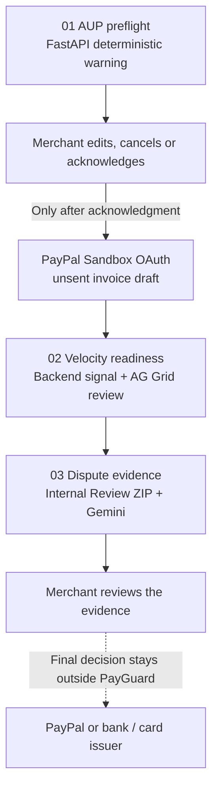

# PayGuard AI

A merchant may notice a policy warning, a sudden sales spike, or a dispute only after the records have become difficult to assemble. PayGuard AI is a **merchant defense buffer layer**: it helps the merchant identify evidence gaps early and prepare evidence, while keeping every decision with the merchant and the relevant payment provider.

This is a US-only, synthetic-data PayPal Sandbox demonstration with one end-to-end merchant workflow:

**At a glance:** AUP warning before a draft → sales-velocity evidence review → dispute evidence ZIP and a Gemini evidence brief. The merchant checks each step; PayPal or the applicable issuer keeps the final decision.

**How it relates to PayPal's own tools:** PayGuard does not replace PayPal's Resolution Center or seller protection and decides no case. It works on the merchant side before and around them: it flags policy wording before an invoice draft, shows whether a sales spike has the order records to back it, and prepares an evidence draft that a person reviews against PayPal's official sources. No merchant interviews or pain-point statistics are claimed; the problem statement is a design premise, not a measured finding.

**Why these three situations:** the stages follow published decisions of the UK Financial Ombudsman Service about PayPal accounts, checked against the published PDFs on 2026-10-31. [DRN-3621543](https://www.financial-ombudsman.org.uk/decision/DRN-3621543.pdf): an e-liquid seller could no longer receive payments because the goods needed PayPal's pre-approval under its Acceptable Use Policy (complaint not upheld). [DRN-5706769](https://www.financial-ombudsman.org.uk/decision/DRN-5706769.pdf): a new business account with a sharp rise in sales had part of its funds held and a 15% rolling reserve applied (the reserve was found reasonable; GBP 150 was awarded for an unexplained delay in releasing funds). [DRN-3526295](https://www.financial-ombudsman.org.uk/decision/DRN-3526295.pdf): a buyer's Buyer Protection claim over a watch that did not match its description (upheld; this is the buyer's side, which PayGuard does not act for). These are UK decisions about PayPal's UK and European entities, not US cases, and three cases show a pattern, not an incidence rate. The author collected further public sources for the project; they are not included in this repository.

**Time evidence (synthetic case 2):** a buyer pays for a digital item, no order record exists yet, the seller delivers later, and a refund claim lands inside that gap. PayGuard keeps the payment time, the order-record time, message records (a channel, a direction, a time, a closed topic and a keyed digest, never text), the delivery time and the claim time in one ordered record inside the Internal Review ZIP (`timeline.json`, schema v2), computes the gaps between them, and lists neutral timestamp flags. Every event except the claim time is marked seller-provided and not verified. It states no intent, predicts no outcome and gives no legal advice; PayPal and the card issuer decide. A digital delivery (channel and time) can stand in for a tracking number as fulfilment proof; mapping it to PayPal's `PROOF_FOR_SOFTWARE_OR_SERVICE_DELIVERED` request type is not implemented, and nothing is submitted.

**Working stack:** PayPal Sandbox OAuth, an unsent invoice draft and read-only Disputes readback · FastAPI and deterministic rules · React, Tailwind and AG Grid Community · Gemini on Vertex AI for the evidence brief.

**Verified against the real Sandbox:** on 2026-10-06 17:44 UTC (2026-10-07 in UTC+8) the gateway authenticated with OAuth client-credentials and created one unsent USD 10.00 invoice draft, Sandbox id `INV2-2MTA-PRPQ-4CAJ-W5UW`, status `DRAFT`. On 2026-10-31 the author filed one test dispute (Item Not Received, TWD 158.00) from a Sandbox buyer test account against the Sandbox seller test account. A list read 2.4 minutes after filing was empty; a read 12.7 minutes after filing returned that one case (waiting for the seller's response, inquiry stage), shown in STEP 03 as **Sandbox data**. It is a test case made with two test accounts, not a real merchant case, and a second unsent invoice draft was created the same day. The masked receipt is [docs/evidence/RECEIPT_20261031_live.md](docs/evidence/RECEIPT_20261031_live.md). `./tools/run.sh test` runs 455 tests (2 skipped). The first commit of this repository is dated 2026-10-08, inside the submission period.

**Website / video:** [youtu.be/K28N9QhRp1E](https://youtu.be/K28N9QhRp1E) (2:02) · **Devpost:** [devpost.com/software/payguard-ai-zbsp9l](https://devpost.com/software/payguard-ai-zbsp9l)

| What the console does | PayPal call | Real or fixture |
| --- | --- | --- |
| Connect the merchant | `POST /v1/oauth2/token` (client-credentials) | Real Sandbox call with `PAYGUARD_PAYPAL_OUTBOUND=enabled` and your Sandbox app credentials; without them the call answers 503 `provider_disabled` and nothing is simulated |
| Unsent invoice draft after the AUP preflight | `POST /v2/invoicing/invoices` | Real Sandbox call once connected, status `DRAFT`, never sent; without a connection the console shows the AUP warning and stops before the draft |
| Webhook signature check | `POST /v1/notifications/verify-webhook-signature` | Allow-listed Sandbox endpoint; exercised in tests with hand-written mock responses; needs `PAYPAL_WEBHOOK_ID`; no UI path |
| Read the merchant's dispute list (STEP 03) | `GET /v1/customer/disputes` | Read live on 2026-10-31: one author-created Sandbox test case was listed (labelled **Sandbox data**); other reasons and more rows are covered by mocked-transport tests. Connect your own Sandbox app to run it live. Without a connection a synthetic fixture in the same JSON shape is used, labelled **Fixture data** in the UI |
| Read one dispute | `GET /v1/customer/disputes/{id}` | Read live once for the same test case (HTTP 200); other cases use mocked-transport tests or the fixture |
| Assemble the evidence response | `POST /v1/customer/disputes/{id}/provide-evidence` | Multipart request is built and previewed from the local draft for a dispute id the console itself returned; it is sent only after the local review approval, with `PAYGUARD_PAYPAL_DISPUTE_SUBMIT=enabled`, a Sandbox connection and an explicit `submit: true` |
| Sales-velocity stream, dispute checklist, evidence ZIP | none | Local synthetic data by design |


*AI-generated merchant-side cover illustration (synthetic scene; the product thumbnails on its mock screens are blurred). The working console runs the Sandbox, AG Grid and bounded Gemini actions live; the cover is not a product screenshot.*


*Three-stage workflow map for the US-only synthetic demo; rules and merchants guide local actions, while PayPal and issuers retain final authority.*

## Architecture and tools at a glance

**What PayGuard does well:** one merchant-side path covers policy warning, sales-velocity review and dispute preparation. Deterministic checks make each signal inspectable; AG Grid makes transaction evidence usable; the ZIP and the Gemini brief help a person review without claiming an outcome.



| Part | What the judge can see | Responsibility and limit |
| --- | --- | --- |
| PayPal Sandbox | OAuth connection, one unsent invoice draft and read-only dispute readback | Provider test environment; no payment, invoice send or dispute mutation unless the submit flag is set |
| FastAPI + deterministic rules | AUP warning, local sales-baseline comparison, current-case evidence requests | Produce review signals before any Gemini brief |
| React + Tailwind + AG Grid Community | Merchant console and sortable, filterable transaction evidence | Show the three stages and let a human inspect the records |
| Gemini on Vertex AI | Evidence brief: Gemini selects each sentence from a closed inventory for the stage, over fixed synthetic facts and pinned citations | Suggest what to review; fixed code validates the choice; no submission or decision authority |
| Internal Review ZIP | Pseudonymized evidence copy | Download for human review; not a PayPal submission package |


*System architecture. The diagram separates merchant actions, deterministic checks, Gemini AI and PayPal or issuer authority.*

The [judge quickstart](docs/submission/quickstart.md) walks through the working console; the [editable workflow diagram](docs/submission/payguard_judge_overview.svg) and [detailed architecture diagram](docs/decisions/2026Q4/payguard_us_architecture_status.svg) show the review and implementation boundaries.

Watch the [2:02 public demonstration](https://youtu.be/K28N9QhRp1E) and the [submitted Devpost project](https://devpost.com/software/payguard-ai-zbsp9l). The [submitted project story](docs/submission/devpost_story.md) preserves the current Devpost wording. It shows the synthetic merchant workflow; the [recording script](docs/submission/video_script.md) preserves the longer pre-edit timing plan.

1. **Before a draft — AUP preflight:** use pinned PayPal US AUP references and deterministic rule checks to surface a warning; after merchant review, PayPal Sandbox OAuth supports one unsent invoice draft.
2. **During fulfillment — velocity readiness:** use a backend comparison against a declared local baseline to flag synthetic sales spikes (fifty captures with varied amounts between USD 4.50 and 18.00, totalling 500.00 against a 100.00 per hour baseline); AG Grid Community lets reviewers sort, filter and select the transaction evidence.
3. **After a dispute — evidence preparation:** read the merchant's disputes through the PayPal Disputes API (Sandbox when connected, fixture otherwise), match the current synthetic case's requested seller items, produce a pseudonymized Internal Review ZIP, preview the multipart `provide-evidence` request and, on request, a bounded Gemini evidence brief for human review.

The console uses FastAPI, React, Tailwind and AG Grid Community. Its lazy-loaded analytics workspace combines a sortable and filterable AG Grid transaction stream with order, amount, currency and capture-time columns, three first-party evidence widgets, a single-open mobile evidence accordion and a deterministic local dashboard guide. Deterministic validation runs first. Gemini then selects the wording of each advisory sentence from a closed, pre-approved inventory for the stage, and fixed code validates the choice. Humans control local workflow choices. PayPal retains final authority for PayPal policy, account and internal-dispute decisions; a bank or card issuer retains authority for an external dispute.

The active analytics dependency boundary is AG Grid Community under the MIT licence. No Commercial AG packages are part of the current frontend dependency or lock contract. The MIT license, contributor-rights attestation, third-party notices and exact export manifest travel with the public source package.

**Release status:** the Devpost project is submitted and the 2:02 demonstration is public. The complete repository run instructions below are the functional-demo path; a hosted demo URL is optional and unperformed (hosting was not part of this entry). The default run uses synthetic data and needs no credentials.

## US Sandbox identity boundary

The demo target is the United States and the provider environment is PayPal Sandbox.

- The existing PayPal login is only the Developer-login identity.
- A fictitious Business sandbox account represents the merchant.
- A fictitious Personal sandbox account represents the buyer when needed.
- The operator's live-account type is not changed or inferred.
- A US merchant claim requires an operator-confirmed US Business sandbox seller.
- The Invoicing evidence is one authenticated Sandbox run on 2026-10-06 17:44 UTC (2026-10-07 in UTC+8): OAuth plus one unsent USD 10.00 draft, `INV2-2MTA-PRPQ-4CAJ-W5UW`. Production accounts were out of scope by design.

Scope: a fictitious US Business Sandbox seller. Production eligibility and live-account behaviour were not tested.

## Run locally

Required console prerequisites: Python 3.13, Node.js 20.19 or newer or Node.js 22.12 or newer, npm and uv. The Gemini profile is set up separately and requires Python 3.12. The optional local-model line requires a separately installed LM Studio server with the exact `nvidia-nemotron-3-nano-4b` model reachable only at `127.0.0.1:1234`. Run from the repository root. The project does not load `.env` files.

Windows users must run the POSIX `sh` commands in WSL 2; native Command Prompt and PowerShell runners are not supported.

The public console uses the official PayPal Sandbox REST APIs through its reviewed gateway. The optional Agent Toolkit dependency profile is excluded from this public package; no SDK installation is needed for the demonstrated flow. Start the local API with Python 3.13 using `./tools/run.sh api`.

```sh
python3.13 -m venv .venv
uv pip install --python .venv/bin/python3 -r requirements.lock
./tools/run.sh test
./tools/run.sh api
```

The console starts without the Gemini profile. To validate it separately:

```sh
uv venv --python python3.12 integrations/gemini/.venv
uv pip sync integrations/gemini/requirements.lock --python integrations/gemini/.venv/bin/python3 --require-hashes
./tools/run.sh gemini-check
./tools/run.sh gemini-test
```

In a second terminal:

```sh
cd frontend
npm ci --ignore-scripts --no-audit --no-fund
npm run dev
```

Open `http://127.0.0.1:5173`. The API listens on `http://127.0.0.1:8000`, and Vite proxies `/api`. Stop each process with `Ctrl+C`. Missing runtime dependencies fail closed. API failure displays an error instead of switching to a hidden mock dataset.

Each stage loads its synthetic scenario when you open it: STEP 02 loads the fifty-capture sales burst and STEP 03 loads the dispute case and the provider dispute readback. The **Load** buttons remain for reloading; loading again never duplicates records. The fixture disputes use dates relative to the request time (response due in 7 and 5 days), so they never show as expired.

### Turning on PayPal

The console runs without any key. To exercise the real Sandbox calls, export these variables in the terminal that starts `./tools/run.sh api`, using a Sandbox REST app from your own PayPal Developer Dashboard:

```sh
export PAYGUARD_PAYPAL_OUTBOUND=enabled
export PAYPAL_CLIENT_ID=...          # Sandbox app client id
export PAYPAL_CLIENT_SECRET=...      # Sandbox app secret
./tools/run.sh api
```

Then expand **PayPal US Sandbox connection** in STEP 01 and select **Connect US Sandbox**. After the OAuth receipt shows, STEP 03 reads `GET /v1/customer/disputes` from that account and labels the rows **Sandbox data**. The `provide-evidence` request stays a preview unless you also export `PAYGUARD_PAYPAL_DISPUTE_SUBMIT=enabled`, record the local review approval for the case and submit with the console's gated button (or `submit: true` on the API). An id the console did not return, or a case without approval, is refused (404 or 422). The console never sets that flag for you. The project does not read `.env` files, and credentials never reach the browser, logs or evidence files.

### Turning on Gemini

Without the Gemini profile, **Generate AI brief** shows "Gemini profile not configured" instead of a brief. To enable it, create the Python 3.12 profile described in Run locally above, set `PAYGUARD_GEMINI_OUTBOUND=enabled` and `PAYGUARD_VERTEX_PROJECT=<your Google Cloud project id>` with Application Default Credentials in the API terminal, and restart `./tools/run.sh api`. `./tools/run.sh gemini-check` validates the profile without calling the model. Two things make the profile refuse to run with `ai_configuration_ambiguous`: proxy or Google variables left in the API terminal (`HTTP_PROXY`, `HTTPS_PROXY`, `GOOGLE_API_KEY`, `GOOGLE_APPLICATION_CREDENTIALS`, `GOOGLE_CLOUD_PROJECT`, `GCLOUD_PROJECT`; unset them and use `gcloud auth application-default login`), and an Application Default Credentials project that differs from `PAYGUARD_VERTEX_PROJECT`. The model runs in the Vertex location `global`.

See the [judge quickstart](docs/submission/quickstart.md) for the bounded walkthrough.

## Three-stage contract

### 1. US AUP preflight screen

PayGuard checks required product fields and deterministic terms against a pinned public US AUP reference. A match produces `REVIEW_SIGNAL`; no match produces `NO_MATCH`. Both retain `compliance_decision=NOT_MADE` and `current_policy_applicability=NOT_ESTABLISHED`.

When a warning appears, the merchant may edit, cancel, or acknowledge and continue to the ordinary provider-gated review. PayGuard does not declare the activity compliant, prohibited, legal, approved or safe. It never rewrites wording to evade a policy.

### 2. Fulfillment and velocity evidence readiness

PayGuard compares synthetic transaction counts and values with a declared local baseline and its preceding comparison window. It may produce `review_velocity`. The result is a local anomaly and evidence-readiness signal. It is not a PayPal risk score, AML finding, fraud finding or prediction of a hold, limitation, reserve or release.

Tracking, shipment and delivery information may be relevant evidence. They do not guarantee Seller Protection, early fund release, removal of a limitation or a dispute outcome.

### 3. Dispute evidence mediation

PayGuard resolves a closed synthetic provider-response fixture by its current reason, status, lifecycle stage, seller-response due date, available actions and evidence requests. Only exact `REQUESTED_FROM_SELLER` plus `PROVIDE_EVIDENCE` requests create seller requirements. It validates separately bound proof and attachment metadata, keeps raw provider identifiers and the restricted synthetic layer in expiring server-side session memory, exposes only non-identifying case/order/request references, creates a pseudonymized internal review copy and can package that safe projection into an integrity-checked Internal Review ZIP. The archive is local, excludes restricted originals and attachment bytes, and retains `NOT_PERFORMED`, `NOT_MADE` and human-review authority boundaries. The backend recomputes the restricted digest before reuse, Gemini eligibility or local approval. The runtime reads PayPal disputes only through a connected Sandbox (GET) and sends evidence only with `PAYGUARD_PAYPAL_DISPUTE_SUBMIT=enabled` plus local approval, all on synthetic data; it does not persist real PII or route cases between PayPal and bank or card issuers. A generic checklist never overrides the current provider response.

Evidence completeness is separate from authenticity, sufficiency, program eligibility and outcome. Counterfeit goods may be a Purchase Protection SNAD issue, while SNAD is outside US Seller Protection. Photos are optional evidence unless the current case specifically requests them.

## Official-reference profile

The active profile is `data/knowledge/payguard_us_official_v2/` and contains:

- 16 official source identities;
- 29 bounded English paraphrase chunks;
- three synthetic scenario cards for the three stages.

It includes official PayPal US policy pages, jurisdiction-neutral PayPal Developer documentation and two official U.S. court procedural records. Developer documentation is not US law. The court records describe allegations and procedural outcomes; they are not current policy or final individual merits findings. No reviewed official case proves that rapid sales growth alone caused an account limitation.

See the [official source register](docs/decisions/2026Q4/us_official_source_register.md) and [US mainline contract](docs/decisions/2026Q4/us_mainline_contract.md).

## Provider and model evidence

Outbound Sandbox access is disabled by default and requires the operator's explicit local opt-in. Credentials remain in the backend process environment and must never enter the repository, frontend, screenshots, prompts or reports.

Sandbox run: at 2026-10-06 17:44 UTC (2026-10-07 in UTC+8) one run under the operator's own US Business Sandbox app completed an OAuth client-credentials request and created one unsent USD `10.00` invoice (Sandbox id `INV2-2MTA-PRPQ-4CAJ-W5UW`, status `DRAFT`), with no send, payment, capture, refund or retry. The raw responses hold account data and are not stored in this repository; the facts above are the sanitized record. To replay the Sandbox path yourself, set `PAYGUARD_PAYPAL_OUTBOUND=enabled` with your own Sandbox app credentials (see "Turning on PayPal" above); the fixture mode shows the same three stages without any key. Invoice creation and invoice sending remain separate operations. The invoice was not read back after creation. Production, invoice send, payment, capture and refund remain frozen; dispute evidence submission is a separate opt-in (`PAYGUARD_PAYPAL_DISPUTE_SUBMIT=enabled`) and is off by default.

The Gemini path is bounded to fixed synthetic facts, pinned citation identities and no automatic retry. A live `gemini-3.8-flash` call on Vertex AI completed on 2026-10-06 10:48 UTC (dispute stage, 3.5 s; the receipt was recorded locally by the author and is not included in this repository); to reproduce it you need your own Vertex AI project (see "Turning on Gemini"). The caller sends only the stage name; the server supplies the fixed synthetic facts and pinned citations, Gemini selects each sentence of the brief from the stage's closed inventory, and fixed code validates the selection. The model cannot select jurisdiction, change deterministic results or authorize a provider action.

The current runtime adds a process-local denial-of-wallet guard around this path: three permanent attempt reservations total, one for each fixed stage. Disabled or invalidly configured AI requests do not consume a reservation. After enablement and deterministic context validation, reservation occurs atomically before the provider call; failures, timeouts, cancellation and invalid responses still consume the stage slot. Session reset, expiry and new sessions do not restore it. This is a local prototype control, not a production distributed quota. A public multi-worker or multi-instance deployment must use a durable shared atomic reservation store plus API-gateway rate and budget circuit breakers so restart, another worker or another instance cannot restore capacity.

The server-owned `payguard-bounded-advisory-v2` prompt contract accepts no caller prompt. It treats every value as data, uses only fixed synthetic facts and opaque pinned citation IDs, disables tools, function calling, streaming, external retrieval and automatic retry, and permits generated text only from stage-specific response-schema enums. Backend validation rechecks the exact prompt-contract digest, citation order, text inventory and authority fields after generation.

The AI integration is a dual-line adapter boundary. `./tools/run.sh api` keeps the existing default Gemini line. `./tools/run.sh local-ai-api` explicitly selects the default-off LM Studio line; it has no key, proxy, remote URL, caller-supplied model or automatic fallback. Both lines share the same stage-only request, prompt digest, closed text inventory, citation order, no-action fields and process-local three-attempt budget. The frontend accepts only the valid model/evidence pairs. The two providers are never called together.

The local line fixes the endpoint to `http://127.0.0.1:1234/v1/chat/completions`, the model to `nvidia-nemotron-3-nano-4b`, structured JSON output, `reasoning_effort=none`, no tools, one serialized in-flight inference and no retry. The public source contains structural and synthetic tests for this contract. The Gemini brief was exercised against Vertex AI `gemini-3.8-flash` in a validated operator-run call on 2026-10-06 (10:48 UTC, 3.5 s, no automatic retry) and again in the current-byte rehearsal; Gemini selects the brief's sentences from the stage's closed inventory and fixed code validates them; the console also starts without a Gemini profile.

## Validation

The number you can reproduce from this repository is the one `./tools/run.sh test` prints (455 tests, 2 skipped).

Use the project-local runner and frontend build:

```sh
./tools/run.sh test
./tools/run.sh demo
./tools/run.sh evaluate
npm --prefix frontend run build
node tests/frontend_ai_contract.mjs
node tests/frontend_operator_labels.mjs
node tests/frontend_recording_contract.mjs
node tests/frontend_zip_contract.mjs
node tests/frontend_zip_api_parity.mjs
```

Gemini-profile validation remains separate:

```sh
./tools/run.sh gemini-check
./tools/run.sh gemini-test
```

Measured scope: `./tools/run.sh test` runs 455 tests (2 skipped) against synthetic data, mocked transports and the built-in fixture; the Sandbox OAuth and invoice-draft calls are covered by receipts (2026-10-06 and 2026-10-31 UTC), the dispute list and one single-dispute read by one author-created Sandbox test case (2026-10-31), and other dispute rows and webhook calls by MockTransport tests. Not covered: multi-instance or hosted operation and real-record behaviour.

## Architecture, privacy and release boundary

- [Current architecture and status](docs/decisions/2026Q4/architecture.md)
- [Console contract](docs/decisions/2026Q4/console_contract.md)
- [Policy engine contract](docs/decisions/2026Q4/policy_engine_v1.md)
- [Case intake contract](docs/decisions/2026Q4/case_intake_contract.md)
- [Threat model](docs/decisions/2026Q4/threat_model.md)
- [Standalone architecture/status visual](docs/decisions/2026Q4/payguard_us_architecture_status.svg)
- [Security policy](SECURITY.md)

The default dataset is synthetic and session-bound. Pseudonymization is not complete anonymization. What is in this release: the three-stage console, 455 tests, the Sandbox gateway (OAuth, unsent invoice draft, Disputes readback, gated provide-evidence) and the fixture data. What is not: multi-tenant auth, logistics feeds, automatic dispute ingestion, cloud deployment.

The MIT license, contributor-rights attestation and third-party notices are present in the source package. The manifest distinguishes the default local-review state from the explicit published-source state. The demonstration video is public; the Devpost project is submitted. Later source revisions require fresh release review.
