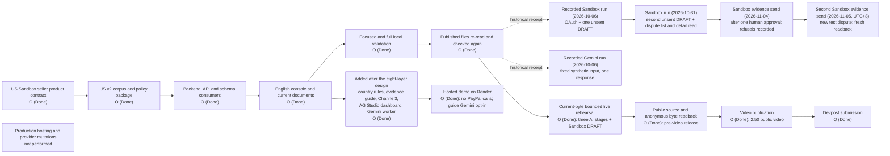
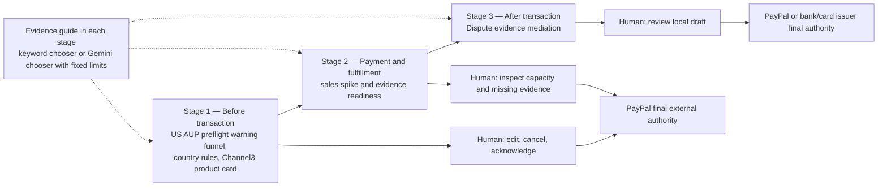
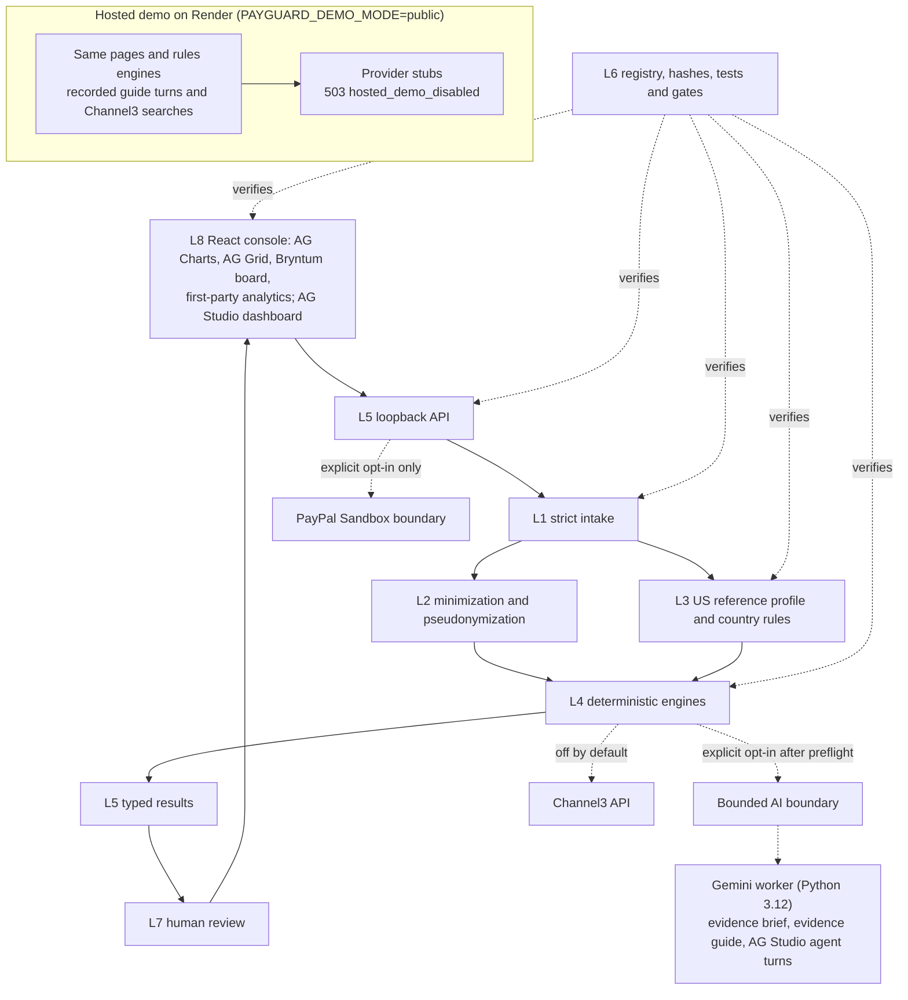

# TradeGlot Eight-Layer Architecture (US Sandbox seller; the optional ten-country rules check is advisory)

> Update 2026-11-11: the current video is the 2:32 cut (https://youtu.be/upx5eZYOmC0); the 2:59 cut of 2026-11-10 (since removed from YouTube) is the one before it; "the 2:50 video" below means the earlier cut. Six evidence sends are recorded now: five from the local console and one from the hosted demo on 2026-11-10 (see README "Real vs simulated" and `docs/evidence/RECEIPT_20261110_hosted_live.md`). The rest of this file is the design record as dated.

Status: accepted local design, updated 2026-11-05. Real PayPal Sandbox runs: OAuth and unsent invoice drafts on 2026-10-06, 2026-10-31 and one during the video recording on 2026-11-05 (UTC+8); dispute list and detail reads on 2026-10-31, and again around each send; two gated `provide-evidence` sends on 2026-11-04 (PayPal-Debug-Id `f908765a01293`) and 2026-11-05 in UTC+8 (PayPal-Debug-Id `f2088142a6218`), each to its own author-created test dispute, with refusals for an already-answered dispute, a different reason and a different amount (masked receipts in `docs/evidence/`). PayPal Sandbox accepting a request is not PayPal accepting the evidence. Each recorded Sandbox and Gemini run is evidence for its own captured execution; they do not prove current-byte live behavior or bind a later source candidate. Release state is determined by the package manifest and exact anonymous public readback. When the manifest is `PUBLIC_SOURCE_PUBLISHED` with `publication_authorized=true` and the same bytes pass exact anonymous readback, public source publication is complete. In that published-source state, the Devpost project is submitted; the 2:50 video is already public. A package marked `LOCAL_EXPORT_CANDIDATE_REVIEW_REQUIRED` has not crossed the public-source gate.

## Product boundary

TradeGlot is an advisory merchant console for a United States PayPal Sandbox demonstration. It implements three linked stages:

1. pre-transaction US Acceptable Use Policy (AUP) preflight warning funnel and the optional ten-country rules check;
2. payment and fulfillment sales spike evidence readiness;
3. post-transaction dispute evidence mediation, ending in a gated Sandbox send after one human approval.

The architecture follows four authority rules:

- deterministic validation and routing run before AI;
- AI extracts and summarizes but does not choose jurisdiction, change a rule result or decide an outcome;
- humans control local edit, cancel, acknowledge and review choices;
- PayPal retains final authority for PayPal policy, account and internal-dispute decisions, while a bank or card issuer retains authority for an external dispute.

TradeGlot does not freeze funds, approve compliance, predict hidden provider thresholds, send invoices, pay, capture, refund, appeal or adjudicate. It submits dispute evidence only through the gated `provide-evidence` request (local reviewer approval, `PAYGUARD_PAYPAL_DISPUTE_SUBMIT=enabled`, a connected Sandbox, an explicit `submit: true` and the server's single-use send confirmation).

## Current status map

This graph describes the accepted local design and separates historical receipts from the separately reviewed current-byte rehearsal. The recorded runs of 2026-10-06 retain only their original bounded claims; a later sanitized receipt (kept by the author, not in this repository) records three validated AI stages, one Sandbox OAuth and one unsent invoice DRAFT in a single session. The 2026-10-31, 2026-11-04 and 2026-11-05 Sandbox runs have masked receipts in `docs/evidence/`. Source publication is established only when the published manifest and exact anonymous readback agree for that candidate. The complete repository run instructions are the selected functional-demo path. The [2:50 video](https://youtu.be/_GORnHWShU4) is public; the Devpost project is submitted. The optional hosted demo runs on Render (`PAYGUARD_DEMO_MODE=public`, no PayPal calls; the guide may use Gemini when the operator opts in, at most 5 calls a minute and 20 a day); a hosted deployment with PayPal calls is unperformed.

## Eight layers

Module names such as `M-POLICY` are the project's own labels for each layer.

| Layer | Modules | Responsibility | Current safe behavior | Open boundary |
| --- | --- | --- | --- | --- |
| L1 — Ingest | `M-INGEST` | Validate event source, request kind, identifiers, timestamps, required fields and deterministic route | Accept bounded synthetic input and an explicit US context; reject unsupported or ambiguous routes | Authentic provider event ingestion and durable replay inbox remain open |
| L2 — Privacy | `M-PRIVACY` | Minimize, pseudonymize and classify sensitive fields | Process fixed synthetic evidence in memory; return redacted text and limited metadata | Real PII, vault, retention enforcement and complete recall remain open |
| L3 — Policy | `M-POLICY` | Load a versioned policy profile, bind source identity and preserve time semantics | Load one pinned US `REFERENCE_ONLY` package; effective interval and account applicability stay unestablished | Full rule lifecycle, promotion, legal review and account-specific applicability remain open |
| L4 — Engines | `M-ENGINES` | Run deterministic AUP, sales spike, completeness, retrieval and advisory gates | Emit warnings, local anomaly signals, missing evidence and bounded citations; the current-byte rehearsal validated one bounded AI response per fixed stage | Full declarative interpretation, repeatability, semantic quality beyond the fixed samples and real-record behavior remain open |
| L5 — API and Report | `M-API`, `M-REPORT` | Enforce strict HTTP/I/O contracts and present backend-owned calculations | Loopback session/CSRF/quota controls; in the hosted demo only, one exact public host behind the proxy (`X-Forwarded-For`, `X-Forwarded-Proto: https`) and the per-visitor and store-wide `TrafficGate`; no frontend risk recomputation; fixed sanitized errors | Provider telemetry, separate readback and durable external action records remain open |
| L6 — Governance | `M-GOVERNANCE` | Bind files, hashes, tests, source provenance, evidence and release state | One file registry, one list of open gaps, changes tried in a scratch copy first, a strict check, a second check that finds nothing left to change, and earlier read-backs kept as they were | Every changed release requires a matching manifest, release evidence and exact anonymous public readback; production deployment requires separate acceptance |
| L7 — Human Review | `M-REVIEW` | Bind actor choice to case/action/payload digest, nonce and expiry | Short-lived local acknowledgement and draft review; edit/reset/expiry revoke prior approval | Durable authenticated actor, tenant and restart/concurrency semantics remain open |
| L8 — Presentation | `M-PRESENT`, `M-UI` | Render backend state, references, limitations and operator controls | English console for a US Sandbox seller (the optional ten-country rules check is advisory), AG Grid Community, a lazy-loaded first-party analytics workspace, a four-column backend-supplied transaction stream, single-open mobile evidence accordion and a deterministic local dashboard guide | Repository instructions are the selected demo path; same-version public artifact proof requires manifest binding and exact anonymous readback; the optional hosted demo runs on Render with no PayPal calls (the guide may use Gemini when the operator opts in); hosting with PayPal calls is unperformed |

## Three-stage lifecycle

### Stage 1 — US AUP preflight warning funnel

Input: a bounded synthetic product or service description plus explicit US policy context.

Processing order:

1. validate required fields and format;
2. run deterministic term/category matching against the pinned US AUP reference;
3. produce `NO_MATCH` or `REVIEW_SIGNAL` with `compliance_decision=NOT_MADE`;
4. show source identity, visible source date, limitations and the official link;
5. let the merchant edit, cancel, or acknowledge and continue to ordinary provider-gated review;
6. request a bounded Gemini summary after deterministic validation;
7. leave every external policy and provider decision to PayPal.

Required-field validation may stop an incomplete local draft. The AUP warning does not create a local compliance hard block. A no-match does not grant clearance.

### Stage 2 — Fulfillment and sales spike evidence readiness

Input: bounded synthetic transactions, a documented local baseline and fulfillment evidence fields.

The backend calculates count, value and ratio inside a defined observation window against a declared preceding baseline window. It may emit `review_velocity`. The result means only that the local demonstration threshold was exceeded or the local input contract requires review.

The UI uses the official terms `hold`, `limitation` and `reserve` when explaining public policy. It never labels the result as AML, money laundering, fraud, PayPal risk score or provider threshold. Tracking may be relevant, but PayPal retains discretion over any provider action or release.

### Stage 3 — Dispute evidence mediation

Input: a bounded synthetic provider-response sample (contract name: fixture) plus separately bound synthetic proof records and attachment bytes, Sandbox disputes read through a connected Sandbox app are a separate path: they are projected, listed and paired with a session case for the `provide-evidence` preview and send, and the resolver below does not run on them.

The deterministic resolver validates reason, lifecycle stage, status, seller-response due date, normalized available actions, current evidence requests, request source, evidence joins, chronology, file signatures, file types and file-size limits. A seller requirement is created only when the current request has both `source=REQUESTED_FROM_SELLER` and `action=PROVIDE_EVIDENCE`; null or unknown actions remain context-only. Static reason templates never invent a missing request.

The runtime produces two bounded products. Restricted original synthetic metadata, including the synthetic attachment bytes (kept for the gated multipart `provide-evidence` send), remains in expiring session memory and never returns file content or the synthetic cases' raw provider case, order or request identifiers to the browser. A connected Sandbox read is different: its `dispute_id` and `seller_transaction_id` are returned to the console so it can show and pair the Sandbox test case. Browser views use non-identifying session references such as `case-ref-001`, `order-ref-001` and `requirement-001`. A separate `INTERNAL_REVIEW_ONLY_V1` pseudonymized JSON copy may be downloaded for local review. The browser can also package the same safe projection into a deterministic seven-entry `INTERNAL_REVIEW_ZIP_V1` archive with a fixed README, manifest, requirement projection, timeline, pinned public sources, pseudonymized evidence and the seller's product reference (`product-reference.json`, `NOT_CONFIRMED` when none was confirmed). The completed archive is parsed before download; fixed authority values, canonical JSON, ZIP metadata and per-payload byte length, CRC-32 and SHA-256 must all match. The ZIP excludes restricted originals, raw identifiers, proof values, attachment names and attachment bytes, and it never represents a PayPal submission package.

Before reuse, AI eligibility or local approval, the backend recomputes and constant-time checks the restricted object digest; the draft digest then binds the browser-visible draft to that verified hidden-layer digest. When a Sandbox app is connected, the console reads the merchant's Sandbox disputes (`GET /v1/customer/disputes` and `GET /v1/customer/disputes/{id}`); otherwise it uses the closed fixture. It builds and previews a `provide-evidence` request, and sends it only behind a recorded local approval, `PAYGUARD_PAYPAL_DISPUTE_SUBMIT=enabled` and an explicit `submit: true`. On 2026-10-31 one author-created Sandbox test dispute was read live (list and detail; [masked receipt](../../evidence/RECEIPT_20261031_live.md)) and no evidence was sent; on 2026-11-04 one evidence send to another Sandbox test dispute succeeded ([masked receipt](../../evidence/RECEIPT_20261104_live.md)); on 2026-11-05 (UTC+8) a second send to a newly filed Sandbox test dispute succeeded ([masked receipt](../../evidence/RECEIPT_20261105_live.md)). The console does not route cases by adjudicator, persist real PII or select an external response. Raw HATEOAS links, PayPal `allowed_response_options` and live authority routing remain provider-adapter fields. PayPal or the issuer retains the applicable external authority.

## Data and control flow

### Components added after the eight-layer design (status 2026-11-04)

The layer table and graphs above predate these parts of the current runtime. Each is described in README.md; this list places them in the layers.

- **Country rules check** (L3/L4, step 01): ten country profiles and their export and import rules (`data/country_rules/`, `/api/v1/country-rules/*`); once a check exists in the session, a ban stops the Sandbox invoice draft with HTTP 409.
- **Evidence guide** (L4/L8): guided gap filling per stage (`/api/v1/guide/*`, five routes). The chooser is a keyword baseline, or with `PAYGUARD_GUIDE_MODEL=gemini` a Gemini chooser through the Python 3.12 worker over Vertex AI or an AI Studio key, governed per session and situation.
- **AG Studio dashboard and built-in agents** (L8, `/dashboard.html`): the agents are off unless `PAYGUARD_STUDIO_AGENTS=gemini`; each turn goes through `POST /api/v1/studio/agent-turn` to the same worker under a separate governor. A question outside the auditor's fixed set goes to Studio's data agent only after a plain "yes" (8-turn cap, judgement-wording check before display).
- **Channel3** (L4, advisory only): a category signal and a product reference card, off by default, replayed from recordings on the hosted demo; case routing (`/api/v1/cases/route`) matches goods text against the recorded catalogue and may make one live product search when a key is set. On the hosted demo the browser loads the recorded card images from `cdn.trychannel3.com`.
- **Bryntum evidence deadline board** (L8, step 03): planning only, kept in the browser tab.
- **PayPal shipment tracking** (`POST /v1/shipping/trackers-batch`; PayPal marks this endpoint deprecated (legacy), and Orders v2 tracking, `POST /v2/checkout/orders/{id}/track`, is the current path, not called by TradeGlot) and the **webhook signature check**: both gated, neither run live.
- **Hosted demo** (L5): `PAYGUARD_DEMO_MODE=public` replaces every PayPal, brief and Studio adapter with a stub (the guide may use Gemini only when the operator opts in, at most 5 calls a minute and 20 a day), answers 503 on provider routes, accepts the one configured public host behind the proxy and adds the `TrafficGate` limits.
- **Pages** (L8): besides the console, the evidence page, `/scenarios.html` (fixed work orders) and `/proof.html` (static proof page).

The browser never receives credentials or access tokens. Provider records never enter the synthetic pool. AI does not receive real merchant, buyer, payment or dispute data in the current scope.

## US source architecture

The active evidence profile is `data/knowledge/payguard_us_official_v2/`:

- `sources.json` contains 16 official source identities;
- `chunks.jsonl` contains 29 bounded English paraphrase chunks;
- `scenario_cards.v1.json` contains three synthetic scenario cards.

Sources have three distinct roles:

| Source class | Role | Authority limit |
| --- | --- | --- |
| Official PayPal US policy | Explain public US policy categories and program terms | Does not establish account-specific applicability or a compliance verdict |
| Jurisdiction-neutral PayPal Developer documentation | Explain Sandbox, API fields and process | Does not become US law, account eligibility or action authorization |
| Official U.S. court procedural record | Provide historical procedural context | Does not become current policy, individual merits truth or a deterministic risk label |

Unsupported jurisdictions fail request validation before any package or corpus access. There is no cross-region fallback. Jurisdiction-neutral technical material cannot satisfy US policy coverage.

## Policy time and state semantics

- `retrieved_at` records when the public source was observed.
- `source_updated_date` records a visible page date when present.
- `effective_date` remains unknown unless the source establishes it.
- observation freshness does not establish legal effectiveness.
- lexical relevance does not establish confidence, applicability or truth.
- `REFERENCE_ONLY` cannot transition an external provider state.

Every policy output retains `current_policy_applicability=NOT_ESTABLISHED`, `compliance_decision=NOT_MADE` and `external_action_authorized=false` unless a future separately governed system introduces stronger evidence and authority.

## Sandbox and model boundaries

### Recorded Sandbox run

The maximum separately reviewed evidence scope is:

- operator-visible confirmation of an eligible US Business sandbox seller;
- Invoicing availability for that seller;
- one sanitized OAuth result;
- one sanitized unsent invoice `DRAFT` creation result;
- independent review of identity, endpoint, request class and response evidence.

The existing login is only the Developer-login identity. A virtual Business sandbox seller is not the operator's live account. A create response is not a separate GET readback. Invoice send, payment, capture, refund and production are frozen. A second Sandbox run on 2026-10-31 created another unsent invoice `DRAFT` and read one author-created test dispute (list and detail); no `provide-evidence` call was made ([masked receipt](../../evidence/RECEIPT_20261031_live.md)). On 2026-11-04 one `provide-evidence` send to an author-created Sandbox test dispute succeeded ([masked receipt](../../evidence/RECEIPT_20261104_live.md)); on 2026-11-05 (UTC+8) a second send to a newly filed Sandbox test dispute succeeded ([masked receipt](../../evidence/RECEIPT_20261105_live.md)).

### Recorded Gemini run

The maximum separately reviewed evidence scope is:

- the fixed bounded synthetic input and exact citation identities;
- the actual model identifier and sanitized response;
- proof that no real business or personal data was sent;
- structural validation and human semantic review;
- preserved `NOT_MADE`, `NOT_ESTABLISHED` and no-action authority.

The source contract permits one Vertex `v1` invocation of `gemini-3.8-flash` in `global`, no automatic retry and no persisted raw response, credential, project identity or environment. The source package alone does not prove that invocation occurred; the recorded Gemini run establishes one bounded fixed-synthetic execution only for its captured provider run and does not establish current-byte live behavior. The runtime adds a process-local three-attempt budget with one permanent reservation per fixed stage. Deterministic readiness and reservation occur atomically before a provider call; every attempted downstream outcome consumes the reservation. The prompt and its SHA-256 identity are server-owned, caller requests contain only the stage enum, and model output is limited to closed stage-specific sentence enums and fixed citation identities. Tools, function calling, retrieval, streaming and caller overrides are unavailable. This protection does not survive process restart or span multiple workers, so any public distributed deployment remains blocked until a durable shared atomic quota and gateway cost circuit breaker are independently verified.

## Gap ownership

| Gap | Boundary | Current consequence |
| --- | --- | --- |
| Sandbox run | OAuth and unsent invoice drafts (2026-10-06, 2026-10-31), dispute list and detail reads (2026-10-31), two gated evidence sends (2026-11-04, 2026-11-05) | Each masked receipt keeps its own scope. Invoice send, payment, capture, refund, shipment tracking, webhook verification, production and broader account behavior are not run |
| Gemini run | One bounded `gemini-3.8-flash` execution and human semantic review | The recorded run retains its original scope; a separate current-byte rehearsal validated one bounded response for each fixed stage. Repeatability, semantic quality beyond those samples, real-record behavior and the optional full policy interpreter remain outside the claim |
| Review authority | Durable external submission authority | Review remains local and short-lived |
| Real data | Real PII ingestion and retention | Only synthetic bounded privacy demonstrations are allowed |
| Source release | Pre-video public source release | Current-byte live proof, same-version release evidence and exact anonymous public readback were accepted for the bounded historical source release. The 2:50 video is public. A changed source candidate needs fresh exact-byte release acceptance; the Devpost project is submitted. The optional hosted demo runs on Render with no PayPal calls (the guide may use Gemini when the operator opts in); hosting with PayPal calls is unperformed and not mandatory |

Internal machine-readable registries remain local release-owner controls and are not linked from the public package. Public documents cannot close a release gate.

## Accepted local baseline and external promotion conditions

The accepted local baseline (US Sandbox seller; the optional ten-country rules check is advisory) has direct evidence that:

1. the AUP and dispute reference profile covers the US only: no foreign policy or case profile, source or fallback; the separate ten-country rules pack is advisory, selects no jurisdiction and has no fallback;
2. unsupported jurisdiction requests fail before loader access;
3. official source identities, dates, classes, limitations and hashes validate;
4. deterministic warning, sales spike and dispute contracts remain unchanged in authority;
5. AI remains post-validation and advisory;
6. focused and full tests, frontend build, rendered desktop/mobile/keyboard review, audit publication, a second check that finds nothing left to change, and a re-read of the published files;
7. historical logs, receipts and superseded bytes remain unchanged;
8. the 2:50 video is public; the Devpost project is submitted; later source revisions need separate evidence-driven release acceptance.

The recorded Sandbox and Gemini runs remain evidence only for their captured executions: the 2026-10-31 receipt for the second draft and the dispute reads, the 2026-11-04 and 2026-11-05 receipts for the two gated evidence sends and their refusals; the separately reviewed current-byte rehearsal (receipt kept by the author) supports exactly its three fixed AI stages, one Sandbox OAuth and one unsent invoice DRAFT. Complete repository run instructions are the selected functional-demo path. Each published candidate still requires matching release evidence and exact anonymous public readback before it can carry `PUBLIC_SOURCE_PUBLISHED`. After that same-byte readback, the Devpost project is submitted and the repository copy matches the accepted public source bytes. The optional hosted demo runs on Render with no PayPal calls (the guide may use Gemini when the operator opts in); hosting with PayPal calls is unperformed, and production hosting plus multi-user AI operation remain unproven and outside the accepted runtime.

Stop if a source digest drifts, a foreign source becomes reachable, an effective date is inferred, a procedural court record is presented as a merits decision, a synthetic receipt is called authentic, or any path enables production or financial mutation.

See the [architecture overview diagram](../../submission/diagrams/architecture_overview.svg), [source register](us_official_source_register.md) and [US seller design contract](us_mainline_contract.md).
