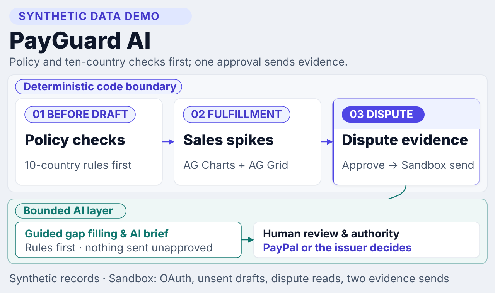

# TradeGlot Judge Quickstart

This walkthrough uses synthetic data, a US official-reference profile for the Acceptable Use Policy (AUP) check and a ten-country rules pack for the country check. It does not require a new outbound provider call. Any recorded provider or model evidence supports only its exact sanitized request and response.



The overview shows the policy and ten-country rules check before a draft and the Sandbox send that runs only after one human approval.

The current demo video is the [2:59 cut](https://youtu.be/o0A-zj2_1rc) (2026-11-10); it replaces the earlier [2:50 cut](https://youtu.be/_GORnHWShU4). The [historical demonstration script](video_script.md) is the plan for the earlier 2:02 cut and has no country rules scene.

The [2:59 demonstration](https://youtu.be/o0A-zj2_1rc) is the final edited video; the script's timestamps belong to the earlier 2:02 cut and are not seek positions in the current video.

Status: the Devpost project is submitted and the 2:59 video is on YouTube. The complete repository run instructions here are the selected functional-demo path. An optional hosted demo also runs (README, "Hosted demo"); its PayPal calls are Sandbox reads and, with its send opt-in (owner decision 2026-11-10, Sandbox test account only), a capped evidence send to the owner's Sandbox test disputes (once per dispute and per visit, at most 2 sends per address per day, 3 per 10 minutes and 15 a day per server run); only its evidence guide can use Gemini when the operator opts in (at most 5 calls a minute and 20 a day); a live hosted evidence send is unperformed in these records so far. A new local export stays `LOCAL_EXPORT_CANDIDATE_REVIEW_REQUIRED` until its exact bytes pass security review, independent acceptance and repository readback; only an accepted same-byte public source release records `PUBLIC_SOURCE_PUBLISHED`. Neither state establishes a public or production-hosted service.

## Fastest path: three clicks on the hosted demo

No install, synthetic data plus Sandbox reads (and, with the send opt-in, a capped Sandbox evidence send). The first visit can take about a minute while the free server wakes. Button labels may be reworded before judging.

1. Open the [start page](https://payguard-demo-j2b3.onrender.com/start.html) and press **Run the step 1 example** in step 01. Expect "A rule may stop this sale.", each row linked to its source.
2. Open step 03, select a case, press **Prepare evidence draft**, then **Download review ZIP**.
3. Open **Proof** in the top bar ([proof.html](https://payguard-demo-j2b3.onrender.com/proof.html)): each claim, how it was shown, the date and the source file.

Which sponsor tool is used where, and how far: the "Sponsor tools at a glance" table in the [README](../../README.md) and [SPONSOR_TECH_MAP.md](../SPONSOR_TECH_MAP.md).

## Start the console

From the repository root:

Windows users must run these POSIX `sh` commands in WSL 2; native Command Prompt and PowerShell runners are not supported.

```sh
python3.13 -m venv .venv
uv pip install --python .venv/bin/python3 -r requirements.lock
./tools/run.sh test
./tools/run.sh api
```

The console starts without the Gemini profile. To validate it separately:

```sh
uv venv --python python3.12 integrations/gemini/.venv
uv pip sync integrations/gemini/requirements.lock --python integrations/gemini/.venv/bin/python3 --require-hashes
./tools/run.sh gemini-check
./tools/run.sh gemini-test
```

In a second terminal:

```sh
cd frontend
npm ci --ignore-scripts --no-audit --no-fund
npm run dev
```

Open `http://127.0.0.1:5173`. Keep both processes running. (`./tools/run.sh start` instead builds the console and serves it on `http://127.0.0.1:8000`; on a terminal it first asks whether the guide may use Gemini, which calls the paid API, default no.) If the API is unavailable, the UI fails visibly instead of loading a hidden mock.

This loopback walkthrough is the selected functional-demo path and runs locally. The optional hosted demo makes only read-only PayPal Sandbox reads and shows less (README, "Hosted demo").

## Understand the banner before the demo

The PayPal Sandbox seller is a US business account; the country rules check covers ten seller and buyer countries. The provider environment is PayPal Sandbox. The existing PayPal login is only the Developer-login identity. A fictitious Business sandbox account represents the merchant, and a fictitious Personal sandbox account represents the buyer when needed.

Any separately reviewed Sandbox proof must identify a US Business Sandbox seller and confirm Invoicing only for that bounded path. Scope: a fictitious US Business Sandbox seller; production eligibility and live-account behaviour were not tested. No credential should appear in the browser, repository, prompt, screenshot or report.

For a recorded take, start a fresh backend so each stage has its single available AI attempt. Configure Sandbox credentials off-screen and select **Connect US Sandbox**, either on the card in the top bar or inside **PayPal Sandbox draft (optional)** (closed by default). The recorded primary view must show **Live Sandbox connection verified** and **Live Sandbox response** without an account, token, invoice identifier or technical receipt.

## Three-stage walkthrough

### Stage 1 — US AUP preflight screen

In the console this stage is titled **Policy pre-check** (step 01).

1. Open step 01 **Policy pre-check**. Optionally, under **Where are you shipping from and to?**, pick **Ships from** and **Ships to**, tick the goods and select **Check country rules**. A ban shows **A rule may stop this sale.** and the server refuses the draft (HTTP 409); a ban that binds only the post shows **The post will not carry this item.** with **Continue with another carrier**. For the draft in step 8, use a route and goods with no stop.
2. Select **High-risk Claim**, then **Run Policy Check**. Confirm that the result is `REVIEW_SIGNAL` and the official PayPal US AUP link is visible.
3. In the **PayPal Sandbox draft (optional)** section (it opens once a check result exists), check **I reviewed the description and amount and confirm that this action creates a Sandbox draft only.**, then select **Confirm Draft Context**. The warning dialog now opens.
4. In the warning dialog, verify the three available choices: **Return to edit**, **Cancel flow**, and **Acknowledge and continue**.
5. For the recording path, select **Return to edit**. Confirm that the prior result, acknowledgement, draft binding and confirmation checkbox are cleared.
6. Select **Standard Item**, then run the policy check again. Confirm **No demo rule matched**.
7. Treat `NO_MATCH` only as no configured demo keyword match. It is not compliance clearance and does not mean compliant, allowed, approved, legal or safe.
8. Check the human confirmation again, select **Confirm Draft Context**, and then select **Create Sandbox draft**. A dialog opens with the item, the amount, the route and "A draft is created in PayPal Sandbox. It is not sent to the buyer." Tick **I checked the item and the amount**, select the orange **Continue**, wait for the 3-second hold and select the green **Create draft**. **Back** or Escape cancels.
9. Confirm **Sandbox invoice draft created**, **Draft · not sent**, and **Not submitted**. The draft line shows only a masked id, `INV2-…` and its last 4 characters; the full invoice identifier does not appear.

Expected boundary: TradeGlot surfaces a public-policy category and a warning. It does not declare the product compliant, prohibited, legal, approved or safe. It does not send an invoice.

### Stage 2 — Fulfillment and sales spike evidence readiness

1. Select **Next: sales burst**. Confirm step 01 closes, step 02 opens, and the page scrolls naturally to it. The synthetic sales burst loads automatically on entry; **Load sales burst** stays in the step header to reload it (the phone action bar drops it once the orders exist) and never duplicates records.
2. Confirm the backend-calculated ratio (5 times baseline), window sales of 500.00 USD and 50 orders. Open **More: sources, limits, examples** and its **Technical details** tab to see the baseline rate, the **Synthetic baseline** label and the baseline window.
3. Select **Orders table** (the step opens on **Chart**), then in the AG Grid sort the **AMOUNT** column. The fifty orders carry ten different synthetic amounts between 4.50 and 18.00 USD, so the sort order changes visibly.
4. Use **Filter orders** to reduce the visible rows to one known order, then clear the filter and confirm all 50 rows return.
5. Select one transaction and inspect its order reference, amount, currency and captured-at UTC value.
6. Confirm the card labels its value as **Stage evidence checklist** and says the stage signal does not classify the selected order as fraud or predict PayPal action.

Expected boundary: the signal means the synthetic activity exceeded a local demonstration baseline. It is not a PayPal threshold, risk score, AML finding, fraud finding or prediction of a hold, limitation, reserve or release. Tracking may be relevant evidence but cannot guarantee release or program eligibility.

### Stage 3 — Dispute evidence mediation

1. Select **Next: dispute evidence**. Confirm step 02 closes, step 03 opens, and the page scrolls naturally to it. The synthetic dispute cases load automatically; **Load dispute case** is hidden once cases exist.
2. Select the case in the case queue.
3. Select **Prepare evidence draft**.
4. Inspect the response deadline, readiness and requested items (for example **Proof of fulfillment**, **Requested from seller**) in the primary view. Expand **Evidence fields and ZIP contents** (named **Evidence fields, requested items, and ZIP contents** in earlier builds) to inspect the evidence fields, the original-identifier summary and the seven ZIP files.
5. Confirm the details say **Original details stay in this session** and **Original files are not included. Nothing is sent.**
6. Select **Download review file** and confirm the provider-submission boundary remains **Not submitted**.
7. Select **Download review ZIP**. The ZIP list under **Evidence fields and ZIP contents** reads **Seven fixed files · generated locally · not sent to PayPal** (7 entries: 6 listed files and the manifest). The fixed archive contains a README, manifest, response-driven requirements, timeline, public citations, pseudonymized evidence and `product-reference.json` (the seller-confirmed Channel3 product card, or `NOT_CONFIRMED`); it contains no raw case ID, order ID, request ID, identity token, session ID, draft digest, proof value, attachment name or attachment bytes.
8. Check the human-review box and record the local review.
9. In **Sample PayPal cases (not real)** (titled **PayPal Sandbox disputes** once connected; the sample disputes' response dates are relative to now, so they never show as expired), confirm the data-source badge. Without a Sandbox connection it reads **Sample** and lists two synthetic disputes in the PayPal Disputes API JSON shape; with a connection made in step 01 it reads **Sandbox** from `GET /v1/customer/disputes`. Select a dispute to read its detail (`GET /v1/customer/disputes/{id}`), then select **Prepare evidence request (preview)** to see the multipart `POST /v1/customer/disputes/{id}/provide-evidence` built from the local draft: the JSON `input` part with masked tracking numbers, the file part metadata and the **Not submitted** boundary. The **Submit to PayPal Sandbox (test)** button stays disabled until the operator sets `PAYGUARD_PAYPAL_DISPUTE_SUBMIT=enabled`, the Sandbox is connected, the local review approval (step 8) is recorded and a preview exists; an id the console did not return is refused with 404 and a missing approval with 422. When enabled, the button opens a dialog that shows the case and the PayPal dispute side by side with the dispute amount, the opening date and the declared account match (the merchant id you configured, not verified with PayPal); tick **I checked this is the right dispute**, select the orange **Continue**, wait for the 3-second hold and select the green **Send to PayPal**. After a send the result shows the PayPal-Debug-Id. The browser waits up to 45 seconds for a PayPal write; a timeout says the write may still have reached PayPal Sandbox.

**Reset demo** asks **Reset the demo?** first. It clears this session's checks, sales, dispute cases, evidence drafts and the local review; your text and the Sandbox connection stay, and a draft already in PayPal Sandbox is not deleted.

Expected boundary: the draft remains local and synthetic. TradeGlot submits evidence only to the Sandbox, and only with the submit flag, a connection and a recorded approval; it does not message a buyer, make an offer, accept a claim, refund, appeal or adjudicate. PayPal decides escalated internal claims. A bank or card issuer decides an external dispute, with PayPal acting as intermediary.

## Sponsor analytics walkthrough

On a desktop viewport wider than 720px:

1. Select **All orders**. The AG Grid Community workspace opens through the explicit navigation action.
2. Confirm that **Review overview** shows the three-stage review path, authority map, session evidence counts and transaction table.
3. Use **Filter visible rows**, column sorting and column filters to inspect the synthetic rows. Confirm that the grid does not recalculate workflow status.
4. Select **Transaction table** and verify that the grid moves to the primary review position without changing row identity or backend state.
5. Use **What needs attention?**, **Explain authority** and **Summarize snapshot**. Confirm that the deterministic local guide performs no external request and cannot send an invoice, move money, submit evidence or decide an outcome.

On a viewport 720px wide or narrower:

1. Expand **Merchant Evidence Buffer** and select **Open all orders**. The responsive evidence summary opens; the desktop AG Grid table, mode switch and guide controls are not shown at this width. At 641–720px, the top-bar **All orders** link also opens this summary.
2. Confirm the single-column review summary. Opening item counts, the compact transaction preview or the authority map closes the prior accordion section. To demonstrate AG Grid sorting and filtering, use a viewport wider than 720px.

Expected boundary: the analytics workspace presents validated synthetic workflow status through AG Grid Community and first-party React components. The local guide never changes the AUP, sales spike or dispute results. The exact source-release state comes from the export manifest; the video is public and the Devpost project is submitted.

## AG Studio evidence dashboard

Open `/dashboard.html` (top bar **Dashboard**). The evidence auditor answers its fixed questions from the rows with plain code. On a local console started with `PAYGUARD_STUDIO_AGENTS=gemini` and a Gemini profile transport, the header chip reads **Built-in agents: live**; the hosted dashboard makes no model call. Ask the starter question **Which reason code appears most often across the three cases?**: because it is outside the auditor's set, the auditor first asks for confirmation (Studio's data agent, Gemini, paid, usually 3 to 6 calls, hard stop at 8, of the 20 allowed per day on this console). Reply **yes** to send it, or ask something else; nothing reaches the data agent before a plain yes. The data agent is told to answer only from the rows in at most two queries, is asked to finish by its fifth turn and stops at 8 turns. Its answer is checked for judgement wording (who wins, at fault, in someone's favour) before it is shown, and the final answer also appears in a status line at the top of the dashboard.

## AI evidence brief

After rule checks, each stage may expose **Generate AI brief**. Without the Gemini profile the panel shows "Gemini profile not configured" and the console continues without it. This action uses approved synthetic facts and fixed source references. The primary result shows the model, mapped execution label, one evidence point, one missing item, source references, **HUMAN REVIEW REQUIRED**, and **No external action authorized**; **View evidence, citations, and limitations** also shows **No decision made** and **Not established**.

The strict API contract still retains:

- `compliance_decision=NOT_MADE`;
- `current_policy_applicability=NOT_ESTABLISHED`;
- `semantic_entailment=NOT_EVALUATED` until human review;
- `external_action_authorized=false`.

The UI validates closed model and evidence identity pairs. The default Gemini line uses `gemini-3.8-flash` with `SYNTHETIC_TEST_RESPONSE` or the separately evidenced `OPERATOR_LIVE_RESPONSE` class. Gemini selects each sentence from the stage's closed inventory and fixed code validates the choice. The Gemini brief has run live on Vertex AI (2026-10-06, and once under the current contract on 2026-11-09); reproducing it needs your own Vertex project. The explicit local line uses `nvidia-nemotron-3-nano-4b` with `LOCAL_RUNTIME_RESPONSE`. The backend launcher selects one line for the process; the browser cannot select a provider and no automatic fallback calls the other line. Neither identity authorizes a provider or workflow action.

## Public references and case caveat

The active source profile contains official PayPal US policy pages, jurisdiction-neutral Developer documentation and two official U.S. court procedural records. The court records describe settlement approval or arbitration procedure. They do not establish final individual merits, current policy or a provider threshold.

No reviewed official case proves that rapid sales growth alone caused an account limitation. The narrower supported statement is that the public US User Agreement lists rapidly increasing typical sales volume among multiple risk examples and says some criteria are confidential.

## Bounded Sandbox evidence

The recorded Sandbox run (2026-10-06 17:44 UTC, 2026-10-07 in UTC+8; recorded by the operator) is one OAuth connection plus one unsent USD `10.00` invoice `DRAFT`, id `INV2-...-W5UW`. A second unsent draft was created on 2026-10-31 ([masked receipt](../evidence/RECEIPT_20261031_live.md)) and a third during the video recording on 2026-11-05, UTC+8 (`INV2-...RG5U`, [masked receipt](../evidence/RECEIPT_20261105_live.md)). All three used the operator's own Sandbox app; to replay them, set `PAYGUARD_PAYPAL_OUTBOUND=enabled` with yours (README, "Turning on PayPal").

- Use a fictitious Business sandbox seller for the merchant role.
- Confirm its country as US before calling it a US seller.
- Confirm Invoicing availability before attempting the draft.
- Keep outbound access off until the operator explicitly enables the bounded attempt.
- Do not retry an uncertain successful create automatically.
- Do not send the invoice or perform payment, capture, refund or dispute mutation, other than the gated provide-evidence send (README, "Turning on PayPal").

Mock transport, screenshots and local UI state do not count as authentic provider evidence.

## Verification commands

```sh
./tools/run.sh test
./tools/run.sh demo
./tools/run.sh evaluate
npm --prefix frontend run build
node tests/frontend_ai_contract.mjs
node tests/frontend_operator_labels.mjs
node tests/frontend_recording_contract.mjs
node tests/frontend_time_evidence_api.mjs
node tests/frontend_zip_contract.mjs
node tests/frontend_zip_api_parity.mjs
```

Gemini-profile validation remains separate:

```sh
./tools/run.sh gemini-check
./tools/run.sh gemini-test
```

These commands validate the local runtime and source contract. The export manifest records the exact source-release state. No verification command authorizes a provider action.

## What the deterministic console demonstrates

- A deterministic warning funnel can surface public US AUP categories before an invoice draft.
- A ten-country rules pack can stop an invoice draft on the server (HTTP 409) when PayPal or a government bans the goods on that route.
- A backend calculation can show a local sales spike against a declared synthetic baseline and preceding comparison window.
- A deterministic intake can organize a synthetic dispute and produce an integrity-checked internal review ZIP while preserving the correct adjudicator boundary.
- A bounded AI adapter can be placed after deterministic validation without receiving decision authority.

## Scope of testing

- A production or live account: only a fictitious US Business Sandbox seller was used.
- A Sandbox dispute through the Disputes calls: the list and one detail were read live on 2026-10-31 for one author-created Sandbox test case, and again before and after each send; on 2026-11-04 one provide-evidence send to another Sandbox test dispute succeeded ([masked receipt](../evidence/RECEIPT_20261104_live.md)); on 2026-11-05 (UTC+8) a second send to a newly filed Sandbox test dispute succeeded ([masked receipt](../evidence/RECEIPT_20261105_live.md)); on 2026-11-09 three more sends succeeded, two of them byte-compared with PayPal's stored file ([read-back note](../evidence/READBACK_20261109.md)); other rows run against mocked transport and the sample disputes; connect your own Sandbox app to run them live.
- Authentic Gemini output on your machine: the brief needs your own Vertex AI project; the guide can use Vertex AI or an AI Studio API key.
- A live hosted evidence send, or multi-user operation (the hosted demo's read-only Sandbox reads were checked once on 2026-11-09; the hosted send opt-in is covered by MockTransport tests only): the console is a loopback demo; the optional hosted demo makes Sandbox reads and, with its send opt-in, the capped evidence send, and only its guide can use Gemini when the operator opts in.

See the [current architecture](../decisions/2026Q4/architecture.md), [official source register](../decisions/2026Q4/us_official_source_register.md) and [US mainline contract](../decisions/2026Q4/us_mainline_contract.md).
